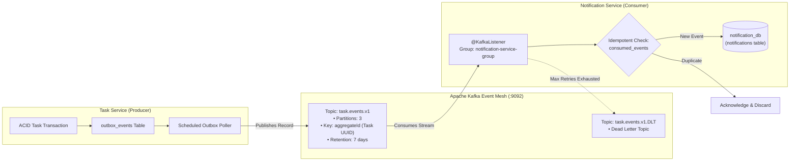

# Event-Driven Architecture Document: Task Management System

| Metadata Item | Details |
|---|---|
| **Document ID** | DOC-EVT-001 |
| **Document Version** | 1.0.0 |
| **Status** | Approved Baseline |
| **Author / Owner Role** | Solution Architect & Software Architect |
| **Creation Date** | 2026-11-03 |
| **Related Documents** | `DOC-ARCH-001`, `ADR-002`, `ADR-005`, `REG-RTM-001` |

---

## 1. Architectural Principles & Paradigm Selection
The Task Management System employs an **Event-Driven Architecture (EDA)** utilizing **Event-Carried State Transfer (ECST)**:
1. **Event-Carried State Transfer**: Rather than emitting empty notifications that force consumers to call back into `task-service` via synchronous HTTP to fetch details, events carry the full point-in-time snapshot of the affected task entity in their payload.
2. **Temporal & Spatial Decoupling**: Producers and consumers run completely asynchronously. `task-service` does not know or care who consumes its events.
3. **Resilience & Backpressure Isolation**: If `notification-service` is halted or restarting, Kafka buffers the event stream safely on disk; consumers resume from their committed offset without losing events.

---

## 2. Event Semantics & Delivery Guarantees
- **Delivery Semantic**: **At-Least-Once Delivery**.
  - Produced via Kafka `acks=all` with `enable.idempotence=true` and retries.
  - Consumed via manual acknowledgment mode (`AckMode.RECORD` or container managed).
- **Consumer Guarantee**: **Effectively-Once (Idempotent) Processing**.
  - Enforced via the `consumed_events` primary key deduplication table in `notification-service`.

---

## 3. Review Checklist
- [x] Event-Carried State Transfer paradigm selected and justified.
- [x] End-to-end event mesh topology mapped with Mermaid.
- [x] At-least-once delivery and idempotent consumption guarantees articulated.

---

## 4. Change History
| Version | Date | Author | Summary of Changes |
|---|---|---|---|
| 1.0.0 | 2026-11-03 | Solution Architect | Initial baseline Event-Driven Architecture document. |

