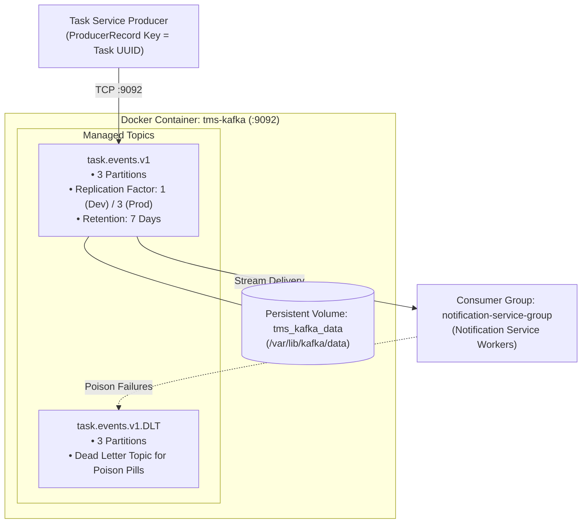

# Kafka Architecture Document: Task Management System

| Metadata Item | Details |
|---|---|
| **Document ID** | DOC-EVT-002 |
| **Document Version** | 1.0.0 |
| **Status** | Approved Baseline |
| **Author / Owner Role** | DevOps Lead & Solution Architect |
| **Creation Date** | 2026-11-03 |
| **Related Documents** | `DOC-EVT-001`, `ADR-002`, `DOC-ARCH-006` |

---

## 1. Broker Topology & Runtime Architecture
The Task Management System utilizes **Apache Kafka 3.7+**. In the containerized local development and CI environment, Kafka runs as a high-performance single-broker instance managed via Zookeeper or native KRaft mode:



---

## 2. Broker Configuration Parameters

| Parameter | Configuration Value | Rationale |
|---|---|---|
| `broker.id` | `1` | Unique broker identifier in the cluster. |
| `listeners` | `PLAINTEXT://0.0.0.0:9092` | Listens on all container interfaces for internal Docker bridge network traffic. |
| `advertised.listeners` | `PLAINTEXT://tms-kafka:9092` | Advertised hostname resolvable by containerized microservices. |
| `num.partitions` | `3` | Default partition count for newly created topics, allowing up to 3 parallel consumers. |
| `default.replication.factor`| `1` (Local Dev) / `3` (Prod) | Single-node local footprint saves host RAM. |
| `log.retention.hours` | `168` (7 days) | Balances replayability buffer with disk storage capacity. |
| `log.segment.bytes` | `104857600` (100 MB) | Standard segment roll limit for efficient cleanup. |
| `log.cleanup.policy` | `delete` | Discards segments older than 7 days. |

---

## 3. Topic Creation Automation
Topics are automatically initialized on startup via a Spring `@Bean` in `task-service`:
```java
@Bean
public NewTopic taskEventsTopic() {
    return TopicBuilder.name("task.events.v1")
        .partitions(3)
        .replicas(1)
        .config(TopicConfig.RETENTION_MS_CONFIG, "604800000") // 7 days
        .build();
}

@Bean
public NewTopic taskEventsDltTopic() {
    return TopicBuilder.name("task.events.v1.DLT")
        .partitions(3)
        .replicas(1)
        .build();
}
```

---

## 4. Review Checklist
- [x] Complete broker topology and Docker listener specifications documented.
- [x] Topic partition counts and 7-day retention policies established.
- [x] Automated Spring TopicBuilder bean configuration defined.

---

## 5. Change History
| Version | Date | Author | Summary of Changes |
|---|---|---|---|
| 1.0.0 | 2026-11-03 | DevOps Lead | Initial baseline Kafka Architecture document. |

