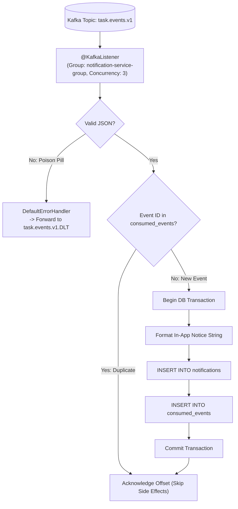

# Consumer Design: Task Management System

| Metadata Item | Details |
|---|---|
| **Document ID** | DOC-EVT-007 |
| **Document Version** | 1.0.0 |
| **Status** | Approved Baseline |
| **Author / Owner Role** | Software Architect |
| **Creation Date** | 2026-11-03 |
| **Related Documents** | `DOC-EVT-001`, `DOC-EVT-008`, `ADR-006` |

---

## 1. Consumer Architecture Overview
In `notification-service`, the **`NotificationEventListener`** subscribes to topic `task.events.v1`. It deserializes incoming JSON payloads into strongly typed `TaskEventEnvelope` objects, verifies idempotency against `consumed_events`, and persists in-app notification records:



---

## 2. Kafka Consumer Configuration (`KafkaConsumerConfig.java`)

```java
package com.chellaa.notification_service.config;

import org.apache.kafka.clients.consumer.ConsumerConfig;
import org.apache.kafka.common.serialization.StringDeserializer;
import org.springframework.beans.factory.annotation.Value;
import org.springframework.context.annotation.Bean;
import org.springframework.context.annotation.Configuration;
import org.springframework.kafka.config.ConcurrentKafkaListenerContainerFactory;
import org.springframework.kafka.core.ConsumerFactory;
import org.springframework.kafka.core.DefaultKafkaConsumerFactory;
import org.springframework.kafka.listener.ContainerProperties;
import org.springframework.kafka.listener.DefaultErrorHandler;
import org.springframework.kafka.support.serializer.ErrorHandlingDeserializer;
import org.springframework.util.backoff.FixedBackOff;

import java.util.HashMap;
import java.util.Map;

@Configuration
public class KafkaConsumerConfig {

    @Value("${spring.kafka.bootstrap-servers:localhost:9092}")
    private String bootstrapServers;

    @Bean
    public ConsumerFactory<String, String> consumerFactory() {
        Map<String, Object> props = new HashMap<>();
        props.put(ConsumerConfig.BOOTSTRAP_SERVERS_CONFIG, bootstrapServers);
        props.put(ConsumerConfig.GROUP_ID_CONFIG, "notification-service-group");
        props.put(ConsumerConfig.KEY_DESERIALIZER_CLASS_CONFIG, ErrorHandlingDeserializer.class);
        props.put(ConsumerConfig.VALUE_DESERIALIZER_CLASS_CONFIG, ErrorHandlingDeserializer.class);
        props.put(ErrorHandlingDeserializer.KEY_DESERIALIZER_CLASS, StringDeserializer.class);
        props.put(ErrorHandlingDeserializer.VALUE_DESERIALIZER_CLASS, StringDeserializer.class);
        props.put(ConsumerConfig.AUTO_OFFSET_RESET_CONFIG, "earliest");
        props.put(ConsumerConfig.ENABLE_AUTO_COMMIT_CONFIG, false); // Manual ack mode

        return new DefaultKafkaConsumerFactory<>(props);
    }

    @Bean
    public ConcurrentKafkaListenerContainerFactory<String, String> kafkaListenerContainerFactory(
            DefaultErrorHandler errorHandler) {
        
        ConcurrentKafkaListenerContainerFactory<String, String> factory = 
            new ConcurrentKafkaListenerContainerFactory<>();
        
        factory.setConsumerFactory(consumerFactory());
        factory.setConcurrency(3); // 3 worker threads matching 3 partitions
        factory.getContainerProperties().setAckMode(ContainerProperties.AckMode.RECORD);
        factory.setCommonErrorHandler(errorHandler);
        return factory;
    }
}
```

---

## 3. Review Checklist
- [x] Concurrent container factory configured with 3 workers matching topic partitions.
- [x] `ErrorHandlingDeserializer` protects against unhandled serialization crashes.
- [x] Manual record-level offset acknowledgment tied to database commit.

---

## 4. Change History
| Version | Date | Author | Summary of Changes |
|---|---|---|---|
| 1.0.0 | 2026-11-03 | Software Architect | Initial baseline Consumer Design document. |

