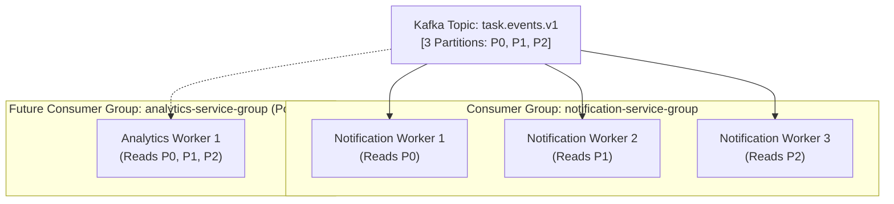

# Consumer Group Strategy: Task Management System

| Metadata Item | Details |
|---|---|
| **Document ID** | DOC-EVT-008 |
| **Document Version** | 1.0.0 |
| **Status** | Approved Baseline |
| **Author / Owner Role** | Software Architect |
| **Creation Date** | 2026-11-03 |
| **Related Documents** | `DOC-EVT-007`, `DOC-EVT-009` |

---

## 1. Consumer Group Architecture & Fan-Out
Kafka's consumer group mechanism allows multiple independent business services to consume the exact same stream of task events without contention:

---

## 2. Partition Assignor Strategy: `CooperativeStickyAssignor`
Traditional Kafka rebalances use eager assignment (`RangeAssignor`), which revokes all partitions from all consumers during a rebalance, causing "stop-the-world" processing pauses.

### Decision
TMS mandates the **`CooperativeStickyAssignor`**:
- **Incremental Rebalance**: Only the specific partition being moved is revoked; consumers holding other unaffected partitions continue processing without disruption.
- **Sticky Affinity**: Consumers retain their assigned partitions across minor scaling events, minimizing cache invalidation.

---

## 3. Offset Management & Consumer Lag Monitoring
1. **Committed Offsets**: Offsets are stored in Kafka's internal `__consumer_offsets` topic.
2. **Lag Tracking**: Consumer lag ($\text{Lag} = \text{Latest Log Offset} - \text{Committed Offset}$) is monitored via Micrometer metrics exported to Prometheus (`kafka.consumer.fetch.manager.records.lag`).
3. **Alert Threshold**: If consumer lag exceeds 500 records for $> 5\text{ minutes}$, Prometheus triggers a warning alert indicating slow downstream database writes.

---

## 4. Review Checklist
- [x] Multi-group event fan-out architecture visualised.
- [x] Modern `CooperativeStickyAssignor` adopted to eliminate stop-the-world pauses.
- [x] Prometheus consumer lag monitoring thresholds established.

---

## 5. Change History
| Version | Date | Author | Summary of Changes |
|---|---|---|---|
| 1.0.0 | 2026-11-03 | Software Architect | Initial baseline Consumer Group Strategy. |

