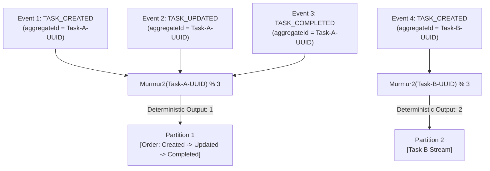

# Partitioning Strategy: Task Management System

| Metadata Item | Details |
|---|---|
| **Document ID** | DOC-EVT-009 |
| **Document Version** | 1.0.0 |
| **Status** | Approved Baseline |
| **Author / Owner Role** | Solution Architect |
| **Creation Date** | 2026-11-03 |
| **Related Documents** | `DOC-EVT-003`, `DOC-EVT-008` |

---

## 1. Partition Key Evaluation Matrix
Kafka guarantees message order **strictly within a single partition**, never across partitions. Selecting the partition key determines whether events can arrive out of order:

| Partition Key Option | Ordering Scope | Traffic Distribution | Out-of-Order Risk | Decision |
|---|---|---|:---:|---|
| **Option A: `null` (Round-Robin)** | None | Perfectly balanced across all partitions. | **Critical Risk**: `TASK_COMPLETED` can be consumed before `TASK_CREATED`. | **Rejected** |
| **Option B: `userId`** | All tasks for a single user | Hotspot risk: Heavy users concentrate traffic on one partition. | Zero for user; risk of partition skew. | **Rejected** |
| **Option C: `aggregateId` (Task UUID)** | **Strict FIFO per individual task** | **Uniform**: Random UUID v4 hashes evenly across all 3 partitions via Murmur2. | **Zero Risk**: Task lifecycle events always arrive in exact sequential order. | **Adopted Baseline** |

---

## 2. Murmur2 Hash Distribution & Deterministic Routing

---

## 3. Scale-Out & Partition Count Stability
Topic `task.events.v1` is provisioned with **3 partitions**.
- **Important**: Changing partition counts on an active Kafka topic alters the Murmur2 modulo base ($\text{hash} \pmod N$), causing subsequent events for existing tasks to hash to different partitions, breaking ordering.
- **Rule**: Partition counts must remain fixed. If throughput demands scaling, partition expansion requires planned consumer drain or topic version migration (`task.events.v2`).

---

## 4. Review Checklist
- [x] Clear evaluation matrix comparing Round-Robin, `userId`, and `aggregateId` keys.
- [x] Murmur2 hash routing guarantees per-task strict FIFO ordering.
- [x] Immutable partition count rule documented to protect ordering integrity.

---

## 5. Change History
| Version | Date | Author | Summary of Changes |
|---|---|---|---|
| 1.0.0 | 2026-11-03 | Solution Architect | Initial baseline Partitioning Strategy document. |

