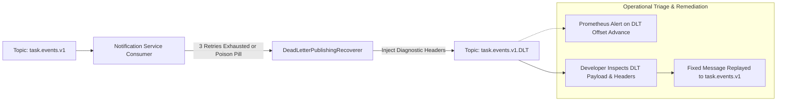

# Dead Letter Topic (DLT) Design: Task Management System

| Metadata Item | Details |
|---|---|
| **Document ID** | DOC-EVT-011 |
| **Document Version** | 1.0.0 |
| **Status** | Approved Baseline |
| **Author / Owner Role** | Software Architect & DevOps Lead |
| **Creation Date** | 2026-11-03 |
| **Related Documents** | `DOC-EVT-003`, `DOC-EVT-010` |

---

## 1. Dead Letter Topic Overview
A Dead Letter Topic (DLT) acts as an isolated holding area for messages that cannot be processed after exhausting all retry attempts or that fail immediately due to fatal serialization/syntax errors (poison pills). Diverting failing messages to a DLT prevents partition head-of-line blocking and allows normal event processing to continue uninterrupted.



---

## 2. DLT Diagnostic Headers Specification
When `DeadLetterPublishingRecoverer` routes a record to `task.events.v1.DLT`, it automatically enriches the message with diagnostic metadata headers:

| Injected Header Name | Type | Value & Forensic Purpose |
|---|---|---|
| `kafka_dlt-original-topic` | String | Original source topic (`task.events.v1`). |
| `kafka_dlt-original-partition`| Integer | Partition index where failure originated. |
| `kafka_dlt-original-offset` | Long | Exact offset of the failing message. |
| `kafka_dlt-original-timestamp`| Long | Original broker message timestamp. |
| `kafka_dlt-exception-fqcn` | String | Fully qualified class name of the thrown exception (e.g., `org.springframework.dao.DataIntegrityViolationException`). |
| `kafka_dlt-exception-message`| String | Error message from the root cause exception. |
| `kafka_dlt-exception-stacktrace`| String | Truncated stack trace for root cause forensics. |

---

## 3. Operational Replay Workflow
1. **Detection**: Prometheus metric `kafka_consumer_records_consumed_total{topic="task.events.v1.DLT"}` triggers an operational alert.
2. **Forensic Analysis**: SRE inspects the DLT payload and headers via Kafka CLI:
   ```bash
   kafka-console-consumer --bootstrap-server localhost:9092 \
     --topic task.events.v1.DLT \
     --from-beginning \
     --property print.headers=true
   ```
3. **Remediation & Replay**: Once the bug or schema issue is patched and deployed, an operations replay script re-publishes the uncorrupted message back to `task.events.v1`.

---

## 4. Review Checklist
- [x] Complete DLT architecture and dead-letter routing flow visualised.
- [x] Spring Kafka diagnostic headers cataloged for root cause debugging.
- [x] Operational inspection and replay procedures documented.

---

## 5. Change History
| Version | Date | Author | Summary of Changes |
|---|---|---|---|
| 1.0.0 | 2026-11-03 | Software Architect | Initial baseline Dead Letter Topic Design. |

