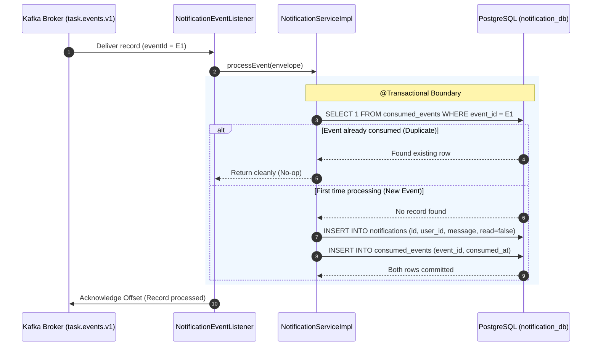

# Idempotency Design: Task Management System

| Metadata Item | Details |
|---|---|
| **Document ID** | DOC-EVT-013 |
| **Document Version** | 1.0.0 |
| **Status** | Approved Baseline |
| **Author / Owner Role** | Software Architect |
| **Creation Date** | 2026-11-03 |
| **Related Documents** | `DOC-EVT-007`, `ADR-006`, `DOC-DB-004` |

---

## 1. Context & At-Least-Once Delivery Reality
In distributed event streaming, network latency, consumer crashes, and partition rebalances mean that Apache Kafka delivers messages with **at-least-once** guarantees. If a consumer processes an event, saves to the database, but crashes before committing its offset to Kafka, the re-assigned consumer re-consumes the identical record.

Without an idempotent consumer design, users would receive duplicate in-app notifications.

---

## 2. Idempotent Consumer Implementation Mechanism



---

## 3. Java Implementation (`NotificationServiceImpl.java`)

```java
package com.chellaa.notification_service.service.impl;

@Service
@RequiredArgsConstructor
@Slf4j
public class NotificationServiceImpl implements NotificationService {

    private final NotificationRepository notificationRepo;
    private final ConsumedEventRepository consumedEventRepo;

    @Override
    @Transactional
    public void processEvent(TaskEventEnvelope envelope) {
        UUID eventId = envelope.eventId();

        // 1. Idempotency Check
        if (consumedEventRepo.existsById(eventId)) {
            log.info("Duplicate event {} detected. Skipping notification generation.", eventId);
            return;
        }

        // 2. Generate Notification Text
        String message = formatNotificationMessage(envelope);

        // 3. Persist Notification Entity
        NotificationEntity notification = NotificationEntity.builder()
            .userId(UUID.fromString(envelope.userId()))
            .eventType(envelope.eventType())
            .message(message)
            .read(false)
            .build();
        notificationRepo.save(notification);

        // 4. Record Event ID in Consumed Events Table
        ConsumedEventEntity consumed = new ConsumedEventEntity(eventId, Instant.now());
        consumedEventRepo.save(consumed);

        log.info("Successfully ingested event {} as notification {}", eventId, notification.getId());
    }
}
```

---

## 4. Review Checklist
- [x] Sequence diagram illustrates atomic check-and-insert deduplication.
- [x] Code implementation verifies both notification and consumed_event persist in same transaction.
- [x] Zero duplicate notifications guaranteed under Kafka redeliveries.

---

## 5. Change History
| Version | Date | Author | Summary of Changes |
|---|---|---|---|
| 1.0.0 | 2026-11-03 | Software Architect | Initial baseline Idempotency Design document. |

