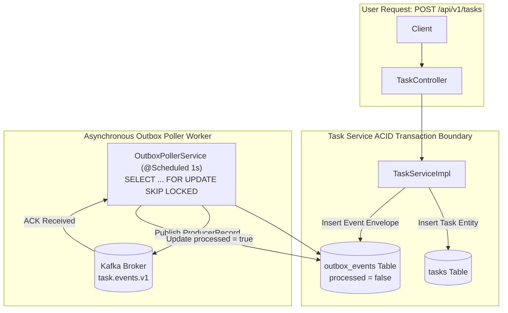

# Transactional Outbox Design: Task Management System

| Metadata Item | Details |
|---|---|
| **Document ID** | DOC-EVT-014 |
| **Document Version** | 1.0.0 |
| **Status** | Approved Baseline |
| **Author / Owner Role** | Software Architect |
| **Creation Date** | 2026-11-03 |
| **Related Documents** | `DOC-EVT-001`, `ADR-005`, `DOC-DB-004` |

---

## 1. Problem Statement: The Dual-Write Dilemma
In microservices, executing a database write and publishing a message to Kafka in the same user request represents two independent network calls. Without a two-phase commit (which is slow, blocking, and unsupported across PostgreSQL and Kafka), one operation can succeed while the other fails:
- Scenario A: DB commits, but Kafka broker is down $\rightarrow$ **Event lost forever**.
- Scenario B: Kafka publish succeeds, but DB transaction rolls back $\rightarrow$ **Phantom notification generated**.

---

## 2. Solution: The Transactional Outbox Pattern



---

## 3. High-Concurrency Poller SQL Query
```sql
SELECT id, aggregate_id, event_type, payload 
FROM outbox_events 
WHERE processed = false 
ORDER BY created_at ASC 
LIMIT 50 
FOR UPDATE SKIP LOCKED;
```
- **Concurrency Guarantee**: If 3 instances of `task-service` run in parallel, each poller instance acquires an exclusive lock on 50 distinct rows and skips all rows locked by peer instances. No threads block; no duplicate messages are published.

---

## 4. Resilience Under Broker Downtime
If the Kafka broker crashes or experiences a network partition:
1. User task creation and updates continue **100% unimpeded**; transactions commit to `tasks` and `outbox_events` in PostgreSQL.
2. The `OutboxPollerService` logs a warning when `kafkaTemplate.send()` fails, leaves `processed = false`, and pauses publication until the next polling cycle.
3. When the Kafka broker recovers, the poller automatically resumes, draining accumulated outbox records in chronological order.

---

## 5. Review Checklist
- [x] Dual-write dilemma and transactional outbox resolution modeled.
- [x] `SKIP LOCKED` query eliminates poller thread serialization.
- [x] Broker partition tolerance verified: zero user-facing impact during Kafka downtime.

---

## 6. Change History
| Version | Date | Author | Summary of Changes |
|---|---|---|---|
| 1.0.0 | 2026-11-03 | Software Architect | Initial baseline Transactional Outbox Design. |

