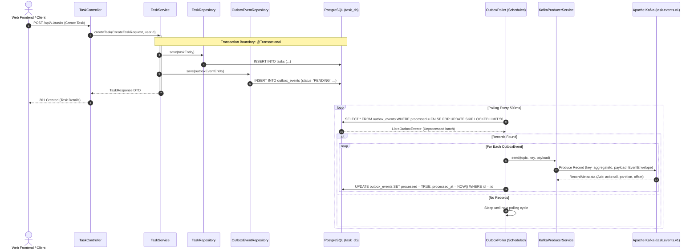
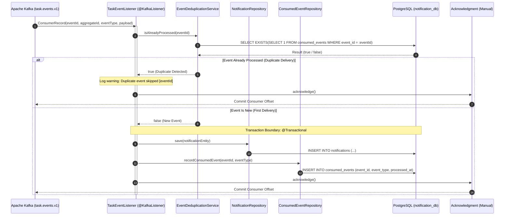
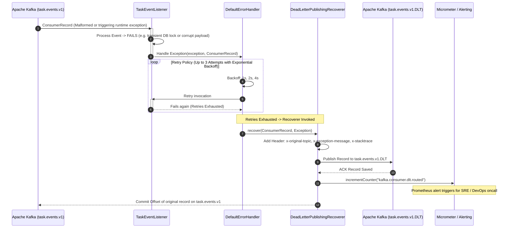

# Event Sequence Diagrams

**Document Identifier:** DOC-ARCH-EVT-SEQ-001  
**Traceability References:** EVT-001, EVT-002, EVT-003, EVT-004, FR-011, FR-012, NFR-006, BRULE-009, BRULE-010  
**Target Services:** `task-service`, `notification-service`, Apache Kafka Cluster  
**Status:** Approved Baseline  

---

## 1. Overview
This document visualizes the complete lifecycle of asynchronous events across the Task Management Microservices platform. These sequence diagrams illustrate the Transactional Outbox pattern, idempotent event ingestion, consumer retry loops, and Dead Letter Topic (DLT) routing for poison pills.

---

## 2. Diagram 1: Task Mutation and Transactional Outbox Publishing
Illustrates the dual-write elimination pattern in `task-service`, where the task entity update and the outbox event are persisted in the same local ACID transaction, followed by asynchronous relay to Kafka.

---

## 3. Diagram 2: Consumer Ingestion and Idempotent Processing
Illustrates consumer deduplication in `notification-service` to ensure exactly-once business outcome despite at-least-once Kafka delivery.

---

## 4. Diagram 3: Poison Pill & Retries Routing to Dead Letter Topic (DLT)
Illustrates resilient failure recovery: transient errors are retried up to 3 times with exponential backoff; deserialization errors or persistent business exceptions are routed to `task.events.v1.DLT`.

---

## 5. Architectural Guarantees Summary
1. **At-Least-Once Delivery**: Guaranteed via `acks=all`, outbox persistence, and transactional polling with status update.
2. **Idempotence & Exactly-Once Semantics**: Guaranteed by client-side deduplication table `consumed_events` using unique primary key `event_id`.
3. **Partition Ordering**: Ensured by using `aggregateId` (`taskId`) as the Kafka message partition key.
4. **Deadlock & Poller Concurrency Control**: Ensured by `FOR UPDATE SKIP LOCKED` during outbox batch polling.
5. **Fail-Safe Processing**: Poison pills are isolated in `task.events.v1.DLT` without blocking pipeline throughput or subsequent consumer offsets.

