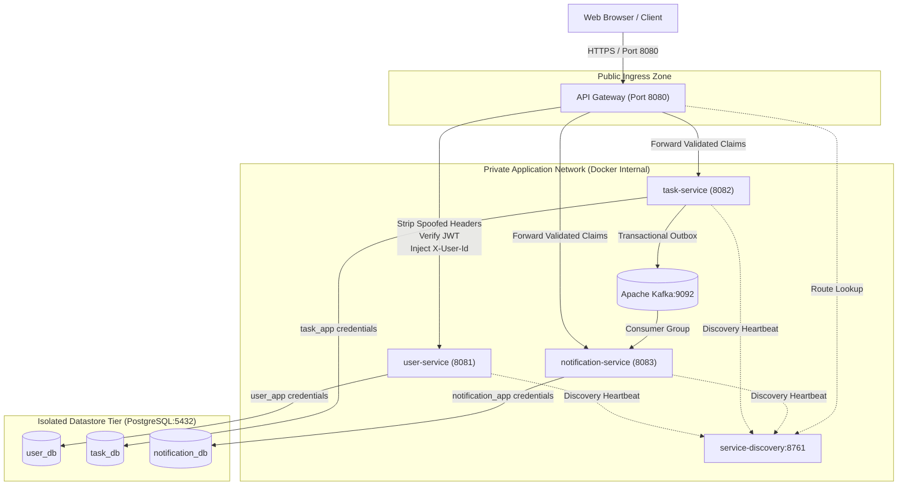

# Security Architecture Document

**Document Identifier:** DOC-SEC-001  
**Traceability References:** SEC-001 to SEC-010, NFR-003, NFR-004, BRULE-002, BRULE-008, ADR-005  
**Target Architecture:** Distributed Microservices Security Mesh  
**Status:** Approved Baseline  

---

## 1. Executive Summary
This document defines the comprehensive, defense-in-depth security architecture for the Task Management Microservices platform. Built upon the Zero Trust principle ("never trust, always verify"), the security model enforces strict multi-layered isolation across edge routing, inter-service networking, application layers, messaging streams, and persistent datastores.

The architecture ensures that every inbound request is authenticated, authorized, validated, and logged with full auditability, while strictly preventing multi-tenant data leakage, privilege escalation, and injection attacks.

---

## 2. Defense-in-Depth Security Model

The system establishes five distinct defensive perimeters:

```
[ Inbound HTTPS Request from Public Internet ]
                      │
                      ▼
┌────────────────────────────────────────────────────────┐
│ Perimeter 1: Network & Edge Layer                      │
│ - Docker bridge network isolation                      │
│ - Host port binding restricted to Gateway (8080)       │
│ - TLS termination & CORS policy enforcement            │
└─────────────────────┬──────────────────────────────────┘
                      │
                      ▼
┌────────────────────────────────────────────────────────┐
│ Perimeter 2: API Gateway Layer (Spring Cloud Gateway)  │
│ - Untrusted header stripping (X-User-Id, X-User-Role)  │
│ - In-memory Token Bucket Rate Limiting                 │
│ - Stateless HMAC-SHA256 JWT validation                 │
│ - Cryptographic claim extraction & header enrichment   │
└─────────────────────┬──────────────────────────────────┘
                      │
                      ▼
┌────────────────────────────────────────────────────────┐
│ Perimeter 3: Application Service Layer                 │
│ - Spring Security filter chain (stateless session)     │
│ - Internal Header Authentication Filter                │
│ - Anti-enumeration query isolation (tenant ownership)  │
│ - Jakarta Bean Validation (Tier 1-4 validation defense)│
└─────────────────────┬──────────────────────────────────┘
                      │
                      ▼
┌────────────────────────────────────────────────────────┐
│ Perimeter 4: Persistence Layer (PostgreSQL)            │
│ - Database-per-service logical separation              │
│ - Dedicated database roles with least-privilege grants │
│ - Hibernate parameterized SQL (SQL injection immunity) │
│ - BCrypt cost factor 12 password hashing               │
└─────────────────────┬──────────────────────────────────┘
                      │
                      ▼
┌────────────────────────────────────────────────────────┐
│ Perimeter 5: Asynchronous Messaging Layer (Kafka)      │
│ - Private Docker network isolation (no public port)    │
│ - JSON Schema validation on ingestion                  │
│ - Transactional Outbox pattern & idempotent consumers  │
└────────────────────────────────────────────────────────┘
```

---

## 3. Core Architectural Security Principles

### 3.1 Zero Trust & Stateless Verification
- No internal service implicitly trusts network traffic simply because it originates inside the Docker network.
- Edge Gateway acts as the Policy Enforcement Point (PEP), verifying JWT signatures before relaying requests downstream.
- Internal downstream services independently verify the presence and validity of trusted identity context injected into request headers.

### 3.2 Anti-Enumeration & Resource Concealment
- When a user attempts to access, update, or delete a resource (`taskId`) that does not belong to them, the system responds with `HTTP 404 Not Found` rather than `HTTP 403 Forbidden`.
- This prevents malicious actors from discovering the existence of resource identifiers belonging to other users.

### 3.3 Fail Securely
- Any unhandled exception or security anomaly defaults to denying access.
- Error responses strictly adhere to RFC 7807 Problem Details and redact stack traces, SQL syntax, table names, and internal class hierarchies.

### 3.4 Complete Mediation
- Every single protected endpoint evaluates authentication and tenant isolation. No internal caching or transient state bypasses security checks.

---

## 4. Security Architecture Topology



---

## 5. Security Requirements Mapping

| Requirement ID | Security Domain | Technical Implementation |
|---|---|---|
| `SEC-001` | Authentication | Stateless HMAC-SHA256 JWT, signed with 256-bit secret, 15-min expiry. |
| `SEC-002` | Authorization | Role-Based Access Control (`ROLE_USER`, `ROLE_ADMIN`) and tenant ID matching. |
| `SEC-003` | Credential Protection | Passwords hashed using BCrypt (cost factor 12) with cryptographically random salt. |
| `SEC-004` | Token Storage | Client stores JWT in memory or secure HttpOnly cookies; no sensitive data in JWT claims. |
| `SEC-005` | Secrets Management | Zero plaintext secrets in Git; environment variable injection at runtime. |
| `SEC-006` | Ingress Protection | Gateway strips incoming `X-User-Id` headers before downstream routing. |
| `SEC-007` | Injection Defense | Hibernate parameterized queries, strict Jakarta Bean Validation (`@Pattern`, `@Size`). |
| `SEC-008` | Information Leakage | RFC 7807 sanitized error responses, MDC masking for passwords and tokens in logs. |
| `SEC-009` | Denial of Service | Token Bucket rate limiter on `/api/v1/auth/**` (5 req/min) and general APIs (60 req/min). |
| `SEC-010` | Transport Security | TLS/HTTPS termination at Gateway, internal container network isolation. |

