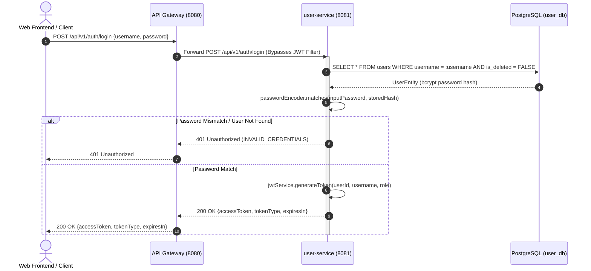
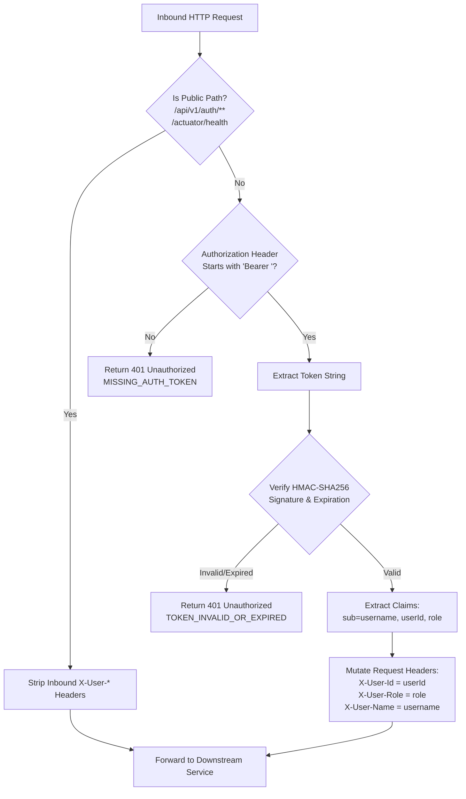

# Authentication Design Document

**Document Identifier:** DOC-SEC-002  
**Traceability References:** FR-001, FR-002, FR-003, SEC-001, SEC-004, US-001, US-002, US-003, UC-001, UC-002, UC-003  
**Target Services:** `user-service`, `api-gateway`  
**Status:** Approved Baseline  

---

## 1. Overview
This document specifies the end-to-end authentication mechanisms for the Task Management System. Authentication is strictly stateless and token-based, utilizing JSON Web Tokens (JWT) signed with symmetric HMAC-SHA256. Primary user authentication takes place in `user-service`, while token validation and claim propagation occur at `api-gateway`.

---

## 2. Authentication Lifecycle

### 2.1 User Registration (`POST /api/v1/auth/register`)
1. **Request Intake**: Client submits `username`, `email`, and `password`.
2. **Syntactic & Semantic Validation**:
   - Jakarta Bean Validation verifies pattern, size, and email format.
   - Database checks verify uniqueness of `username` and `email`.
3. **Password Hashing**: Plaintext password is processed via BCrypt (cost factor 12) with unique 16-byte cryptographically secure salt.
4. **Entity Persistence**: User record is saved with status `ACTIVE` and role `ROLE_USER`.
5. **Response**: Returns `HTTP 201 Created` with `UserResponse` DTO (passwords and hashes are completely omitted).

### 2.2 User Login (`POST /api/v1/auth/login`)
1. **Request Intake**: Client submits credentials (`username` or `email`, and `password`).
2. **Credential Verification**:
   - `UserDetailsService` loads `UserEntity` by username/email.
   - `PasswordEncoder.matches(rawPassword, encodedHash)` evaluates candidate password in constant time.
   - If incorrect: Returns `HTTP 401 Unauthorized` with generic error code `INVALID_CREDENTIALS` (preventing credential enumeration).
3. **Token Minting**: `JwtService` issues a signed JWT containing standard and domain-specific claims.
4. **Response**: Returns `HTTP 200 OK` containing `accessToken`, `tokenType: "Bearer"`, and `expiresIn: 900` (15 minutes).

### 2.3 User Logout (`POST /api/v1/auth/logout`)
- **Stateless Model**: In the MVP, the client purges the access token from its client-side state / memory.
- **Gateway Interception**: The logout endpoint returns `HTTP 200 OK` indicating session termination.
- **Future Expansion**: Token blacklisting via Redis is documented in ADR-005 as a deferred post-MVP enhancement.

---

## 3. Spring Cloud Gateway Authentication Filter

Every protected request entering the gateway passes through the `JwtAuthenticationFilter`:

### 3.1 Gateway Header Sanitization Rule
To prevent client header spoofing, `api-gateway` removes any incoming `X-User-Id`, `X-User-Role`, or `X-User-Name` headers before executing authentication or routing. Downstream services receive only headers explicitly set by the gateway's verified JWT claims.

---

## 4. Downstream Microservice Authentication Handling

Downstream microservices (`task-service`, `notification-service`) do not re-verify cryptographic JWT signatures, minimizing CPU overhead and eliminating shared secret key synchronization.

Instead, downstream services implement an internal `HeaderAuthenticationFilter`:
1. Intercepts incoming requests.
2. Reads `X-User-Id` and `X-User-Role` headers.
3. Constructs a Spring Security `PreAuthenticatedAuthenticationToken` and populates the `SecurityContextHolder`.
4. Populates the `userId` in Slf4j MDC for correlated, audited log traces.
5. If a protected route is requested without an `X-User-Id` header, the service responds with `HTTP 401 Unauthorized`.

---

## 5. Error Code Specifications

| HTTP Status | Error Code | Description | Mitigation / Action |
|---|---|---|---|
| `401 Unauthorized` | `INVALID_CREDENTIALS` | Invalid username or password supplied at login. | User re-enters correct credentials. |
| `401 Unauthorized` | `MISSING_AUTH_TOKEN` | Request to protected API without `Authorization` header. | Client includes `Bearer <token>` header. |
| `401 Unauthorized` | `TOKEN_EXPIRED` | JWT lifetime exceeds 15 minutes. | User re-authenticates to acquire fresh token. |
| `401 Unauthorized` | `TOKEN_MALFORMED` | JWT structure, signature, or padding is corrupted. | Client discards corrupted token and logs in. |
| `401 Unauthorized` | `ACCOUNT_INACTIVE` | User account is soft-deleted or marked inactive. | User contacts system administrator. |

