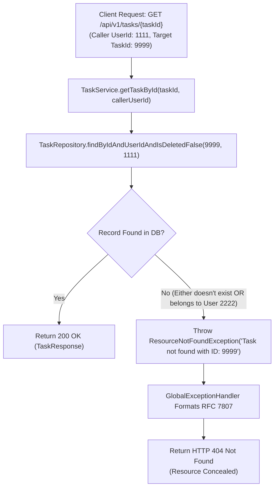

# Authorization Design Document

**Document Identifier:** DOC-SEC-003  
**Traceability References:** FR-004, FR-005 to FR-010, FR-013, SEC-002, BRULE-001, BRULE-002, US-004 to US-010  
**Target Services:** `api-gateway`, `user-service`, `task-service`, `notification-service`  
**Status:** Approved Baseline  

---

## 1. Overview
This document specifies the authorization framework for the Task Management System. The architecture employs a **Two-Tier Authorization Model**:
1. **Tier 1 (Role-Based Access Control - RBAC)**: High-level coarse-grained permission checks evaluated at `api-gateway` and service entry points.
2. **Tier 2 (Tenant / Resource Ownership Authorization)**: Strict fine-grained ownership enforcement evaluated inside the service domain logic and persistence layer.

---

## 2. Role-Based Access Control (RBAC) Specification

The system recognizes two standard system roles:

| Role Name | Authority String | Description & Permissions |
|---|---|---|
| `ROLE_USER` | `SCOPE_USER` | Default standard role assigned upon registration. Can create, read, update, delete own tasks, view own dashboard metrics, and view/mark own notifications. |
| `ROLE_ADMIN` | `SCOPE_ADMIN` | System administrator role. Possesses all standard user privileges plus access to administrative actuator health/metrics monitoring. |

### 2.1 Gateway Route RBAC Matrix

| Route Path | Method | Minimum Required Role | Gateway Action |
|---|---|---|---|
| `/api/v1/auth/**` | POST | None (Permit All) | Direct pass-through |
| `/actuator/health` | GET | None (Permit All) | Direct pass-through |
| `/api/v1/users/me` | GET, PUT | `ROLE_USER` or `ROLE_ADMIN` | Verify JWT, inject headers |
| `/api/v1/tasks/**` | GET, POST, PUT, PATCH, DELETE | `ROLE_USER` or `ROLE_ADMIN` | Verify JWT, inject headers |
| `/api/v1/notifications/**`| GET, PATCH | `ROLE_USER` or `ROLE_ADMIN` | Verify JWT, inject headers |
| `/actuator/**` (all other) | GET | `ROLE_ADMIN` | Block with 403 if not admin |

---

## 3. Resource Ownership Authorization & Anti-Enumeration

### 3.1 The Golden Tenant Boundary Rule
In compliance with `BRULE-001` and `BRULE-002`:
- Every task belongs to exactly one user.
- A user can only access, view, modify, or delete their own tasks.
- A user can only access, view, or mark as read their own notifications.

### 3.2 Anti-Enumeration Defense
To defend against malicious ID harvesting (Insecure Direct Object References - IDOR), the system intentionally **conceals the existence** of resources belonging to other tenants.



> [!IMPORTANT]
> When a user queries a `taskId` belonging to another user, the system returns `HTTP 404 Not Found`, identical to querying a completely nonexistent UUID. It NEVER returns `HTTP 403 Forbidden` for resource lookups, preventing attackers from determining whether an ID is active.

---

## 4. Method-Level and Query-Level Enforcement

### 4.1 Repository Layer Enforcement
All data modifications enforce tenant criteria at the database query level:

```java
public interface TaskRepository extends JpaRepository<TaskEntity, UUID> {
    
    // Ownership is baked into the query predicate
    Optional<TaskEntity> findByIdAndUserIdAndIsDeletedFalse(UUID id, UUID userId);

    @Query("SELECT t FROM TaskEntity t WHERE t.userId = :userId AND t.isDeleted = false")
    Page<TaskEntity> findAllByUserId(UUID userId, Pageable pageable);
}
```

### 4.2 Controller Context Resolution
Controllers extract the authenticated caller's identity directly from the injected request header via a custom `@AuthenticationPrincipal` resolver or `@RequestHeader(SecurityConstants.HEADER_USER_ID) UUID userId`:

```java
@GetMapping("/{id}")
public ResponseEntity<TaskResponse> getTask(
        @PathVariable UUID id,
        @RequestHeader(SecurityConstants.HEADER_USER_ID) UUID authenticatedUserId) {
    return ResponseEntity.ok(taskService.getTaskById(id, authenticatedUserId));
}
```

### 4.3 Profile Endpoint Security (`GET /api/v1/users/me`)
Rather than exposing an endpoint with an ID path variable (such as `/api/v1/users/{id}`), the user profile API exposes only `/api/v1/users/me`. The service resolves the current user strictly from the verified gateway header, making horizontal privilege escalation structurally impossible.

