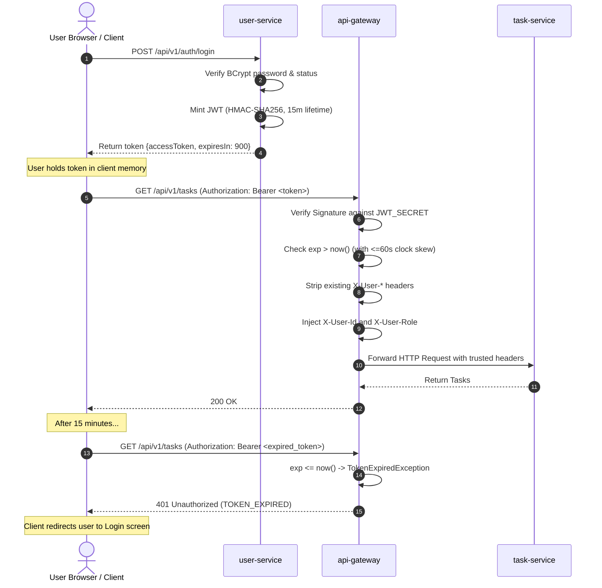

# JWT Lifecycle and Token Management

**Document Identifier:** DOC-SEC-004  
**Traceability References:** SEC-001, SEC-004, ADR-005, NFR-003  
**Target Services:** `user-service`, `api-gateway`  
**Status:** Approved Baseline  

---

## 1. Executive Summary
This document specifies the cryptographic design, claim structure, issuance, verification, expiration, and lifecycle management of JSON Web Tokens (JWT) within the Task Management System. The architecture utilizes stateless HMAC-SHA256 tokens issued exclusively by `user-service` and cryptographically verified at `api-gateway`.

---

## 2. JWT Specification and Claim Structure

Tokens conform to RFC 7519 and are encoded as `Base64URL(Header) . Base64URL(Payload) . Signature`.

### 2.1 JOSE Header
```json
{
  "alg": "HS256",
  "typ": "JWT"
}
```

### 2.2 JWT Claims Payload
```json
{
  "iss": "task-manager-auth",
  "sub": "johndoe",
  "userId": "3fa85f64-5717-4562-b3fc-2c963f66afa6",
  "role": "ROLE_USER",
  "email": "johndoe@example.com",
  "jti": "8b5b8d23-74b8-47a3-b9dc-0cf04407b973",
  "iat": 1709470800,
  "exp": 1709471700
}
```

### 2.3 Claims Data Dictionary
| Claim | Type | Standard | Description | Security Consideration |
|---|---|---|---|---|
| `iss` | String | RFC 7519 | Issuer identifier: `"task-manager-auth"` | Rejects tokens with unknown issuers. |
| `sub` | String | RFC 7519 | Subject: User's unique `username` | Used for logging and user context. |
| `userId`| UUID String | Custom | User's internal surrogate key (`UUID v4`) | Downstream tenant scoping identifier. |
| `role` | String | Custom | User authority (`ROLE_USER` / `ROLE_ADMIN`) | Evaluated for edge route authorization. |
| `email` | String | Custom | User email address | Cached identity convenience claim. |
| `jti` | UUID String | RFC 7519 | Unique JWT ID (`UUID v4`) | Enables replay defense and tracking. |
| `iat` | Long (Epoch Sec) | RFC 7519 | Issued At timestamp | Rejects future-dated tokens. |
| `exp` | Long (Epoch Sec) | RFC 7519 | Expiration timestamp (`iat + 900s`) | Strictly enforced (15-minute lifespan). |

---

## 3. Cryptographic Secret and Signing Policy

1. **Algorithm**: HMAC using SHA-256 (`HmacSHA256` / `HS256`).
2. **Key Material**: Minimum 256 bits (32 bytes) of high-entropy cryptographic randomness.
3. **Key Provisioning**: Sourced strictly via environment variable `JWT_SECRET`. Hardcoding secrets in source files or configuration repositories is strictly prohibited.
4. **Validation Requirements**:
   - The Gateway rejects any token whose header specifies `alg: "none"`.
   - The Gateway rejects any token whose algorithm differs from `HS256` (defending against algorithm substitution attacks).
   - Clock skew allowance is capped at **60 seconds** to accommodate container time sync jitter.

---

## 4. Token Lifecycle Flowchart



---

## 5. Token Storage and Defense Considerations

### 5.1 Client-Side Token Storage
- **Recommended**: Store in JavaScript application memory (e.g. React Redux/Zustand state) to eliminate Cross-Site Scripting (XSS) local storage leakage.
- **Alternative**: Secure `HttpOnly`, `SameSite=Strict`, `Secure` cookie, preventing script-based theft.

### 5.2 Token Revocation Strategy
- **MVP Approach**: Tokens are ephemeral (15-minute lifetime) and fully stateless. User logout triggers client-side token disposal.
- **Post-MVP Redis Blacklisting**: As documented in `ADR-005`, an in-memory Redis cluster can store revoked `jti` identifiers with TTL equal to the remaining token lifetime should immediate revocation be mandated.

