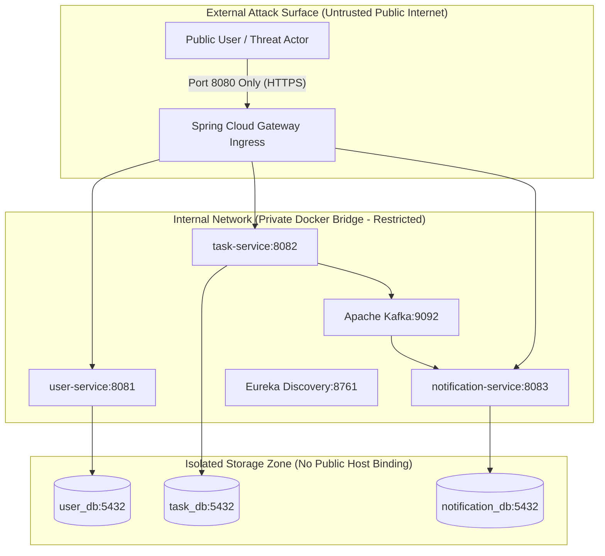

# Threat Model and Attack Surface Analysis (STRIDE)

**Document Identifier:** DOC-SEC-009  
**Traceability References:** SEC-001 to SEC-010, NFR-003, NFR-004  
**Methodology:** Microsoft STRIDE Threat Modeling Framework  
**Status:** Approved Baseline  

---

## 1. Executive Summary
This document delivers a formal threat model and attack surface analysis for the Task Management System using the Microsoft STRIDE methodology. Every architectural interface, protocol boundary, and data transition is evaluated against potential threat vectors, establishing specific countermeasures and residual risk assessments.

---

## 2. Attack Surface Breakdown

| Attack Surface Zone | Exposed Ports | Protocol | Access Controls | Risk Level |
|---|---|---|---|---|
| **Public Gateway Ingress** | `8080` (HTTP/HTTPS) | REST / JSON | Public entry; Rate Limiting, CORS, JWT Signature Check. | High (Exposed) |
| **Internal Microservices** | `8081`, `8082`, `8083` | HTTP (REST) | Internal Docker network only; not published to host. | Medium (Internal) |
| **Service Discovery** | `8761` | HTTP | Internal Docker network only. | Low (Internal) |
| **Message Broker** | `9092` | Kafka TCP | Internal Docker network only; no external listener. | Medium (Internal) |
| **Datastores** | `5432` | PostgreSQL wire | Dedicated database users; container network isolation. | Medium (Internal) |

---

## 3. STRIDE Threat Analysis Matrix

### 3.1 Spoofing (Identity Impersonation)
- **Threat**: Attacker crafts fake JWT tokens or injects spoofed `X-User-Id` headers to impersonate another user.
- **Affected Components**: `api-gateway`, downstream services.
- **Countermeasure**:
  1. HMAC-SHA256 signature verification at the Gateway using high-entropy secret.
  2. Pre-filter strips incoming `X-User-Id` headers before downstream routing.
  3. Downstream services accept `X-User-Id` only over trusted internal network channels.
- **Residual Risk**: Low.

### 3.2 Tampering (Data Modification)
- **Threat**: Attacker tampers with payload data in transit or modifies other users' tasks (IDOR).
- **Affected Components**: `task-service`, `notification-service`.
- **Countermeasure**:
  1. TLS encryption in transit for all client-to-gateway traffic.
  2. Tenant ownership queries enforce `WHERE user_id = :userId` for every update/delete operation.
  3. JSON schema and DTO bean validation reject illegal field mutations.
- **Residual Risk**: Very Low.

### 3.3 Repudiation (Denial of Action)
- **Threat**: User denies performing a destructive action (such as task deletion).
- **Affected Components**: `task-service`, audit logs.
- **Countermeasure**:
  1. Slf4j MDC injects `userId`, `correlationId`, and client IP into structured JSON application logs.
  2. Kafka `TASK_DELETED` events persist in the append-only Kafka commit log with UTC timestamps and user metadata.
  3. Soft-delete mechanism preserves `deleted_at` timestamp and entity history.
- **Residual Risk**: Low.

### 3.4 Information Disclosure (Data Leakage)
- **Threat**: Unauthorized exposure of other users' tasks through ID harvesting, error traces, or unauthenticated endpoints.
- **Affected Components**: All APIs, PostgreSQL databases.
- **Countermeasure**:
  1. **Anti-Enumeration**: Queries for cross-tenant IDs return `HTTP 404 Not Found`, concealing resource existence.
  2. RFC 7807 global exception handler strips all internal stack traces and database schema names.
  3. Passwords stored using BCrypt; passwords excluded from DTO outputs and logs.
- **Residual Risk**: Very Low.

### 3.5 Denial of Service (DoS)
- **Threat**: High-frequency brute-force login requests exhausting CPU during BCrypt hashing, or volumetric HTTP flooding.
- **Affected Components**: `api-gateway`, `user-service`.
- **Countermeasure**:
  1. Gateway in-memory Token Bucket rate limiter limits `/api/v1/auth/**` to 5 requests per minute per IP.
  2. Request payload size capped at 1 MB to prevent buffer exhaustion.
  3. Container memory ceilings (`-Xmx256m`) and thread pool bulkheads prevent host starvation.
- **Residual Risk**: Low.

### 3.6 Elevation of Privilege
- **Threat**: Standard user modifies requests to access administrative endpoints or gains cross-tenant privileges.
- **Affected Components**: `api-gateway`, `user-service`.
- **Countermeasure**:
  1. JWT claims contain authenticated role (`ROLE_USER` / `ROLE_ADMIN`).
  2. Gateway RBAC filters block non-admin tokens from protected administrative/actuator paths.
  3. User registration hardcodes the assigned role to `ROLE_USER`; callers cannot supply their own role.
- **Residual Risk**: Very Low.

---

## 4. Threat Model Summary & Residual Risk Sign-Off

All identified STRIDE threats possess concrete, multi-layered architectural countermeasures. No unmitigated High or Critical inherent risks remain in the baseline design.

