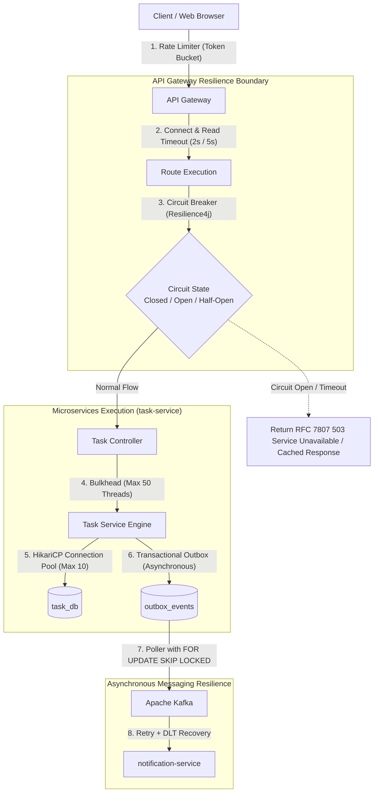

# Resilience Architecture Document

**Document Identifier:** DOC-RES-001  
**Traceability References:** NFR-002, NFR-006, ADR-004, ADR-007  
**Target Services:** All Platform Services & Infrastructure  
**Status:** Approved Baseline  

---

## 1. Executive Summary
This document specifies the distributed resilience architecture for the Task Management System. In a microservices architecture, network latency, host degradation, and service crashes are inevitable failure modes. The platform is designed to expect failure and maintain continuous availability through fault isolation, circuit breakers, rate limiting, bounded timeouts, bulkheads, and asynchronous decoupling.

---

## 2. Core Resilience Objectives
1. **Fault Isolation**: A complete failure of `notification-service` or Kafka broker must never prevent users from logging in or creating/updating tasks.
2. **Elimination of Cascading Failures**: Unresponsive dependencies must fail fast rather than monopolizing gateway and container thread pools.
3. **Predictable Latency Under Stress**: Request latency is bounded through strict timeouts and rate limiters.
4. **Self-Healing Capabilities**: Degraded services automatically probe downstream health and resume normal traffic routing once dependencies recover.

---

## 3. Resilience Pattern Architecture

---

## 4. Resilience Patterns Inventory

| Pattern | Component | Implementation Mechanism | Target Failure Mode Mitigated |
|---|---|---|---|
| **Rate Limiting** | `api-gateway` | In-memory Token Bucket filter | Volumetric denial-of-service and brute-force flooding. |
| **Circuit Breaker** | `api-gateway`, Inter-service | Resilience4j CircuitBreaker state machine | Downstream service outages and cascading latency pileups. |
| **Bounded Timeouts** | Gateway, Feign, JDBC | Netty `responseTimeout`, Hikari `connectionTimeout` | Indefinite thread hanging on stalled network sockets. |
| **Idempotent Retry** | Kafka Consumers, DB ops | Spring Kafka `@RetryableTopic`, Spring Retry | Transient network drops, database lock contention. |
| **Bulkheading** | Services, DB pools | HikariCP pool isolation, dedicated thread pools | Single slow query or endpoint exhausting JVM threads. |
| **Outbox Decoupling** | `task-service` $\rightarrow$ Kafka | PostgreSQL `outbox_events` table | Kafka cluster unavailability during task mutation. |
| **Dead Letter Topic** | `notification-service` | Spring Kafka `DefaultErrorHandler` + DLT | Poison pill messages stalling event consumer pipelines. |

---

## 5. Failure Blast Radius Analysis

| Failed Component | Immediate Impact | Blast Radius Containment | User Experience |
|---|---|---|---|
| `notification-service` | Notifications cannot be consumed or retrieved. | **Zero impact** on `user-service` and `task-service`. Tasks are created normally; events wait in Kafka. | User can manage tasks; notification bell shows temporary error or empty list. |
| Apache Kafka Broker | Outbox poller cannot publish messages. | **Zero impact** on task creation. Tasks and outbox records persist in PostgreSQL. Poller retries automatically. | User creates/edits tasks with full transactional consistency; notifications are delayed until Kafka recovers. |
| `task-service` | Task management operations fail. | Gateway circuit breaker trips to OPEN after 5 consecutive failures, failing fast in <5ms. | Gateway returns `HTTP 503 Service Unavailable` with friendly user message. User authentication remains unaffected. |
| `service-discovery` (Eureka) | Dynamic routing registry unavailable. | Gateway caches last known healthy service IP addresses locally; services continue communicating. | Zero immediate impact on end-user traffic for existing running instances. |

