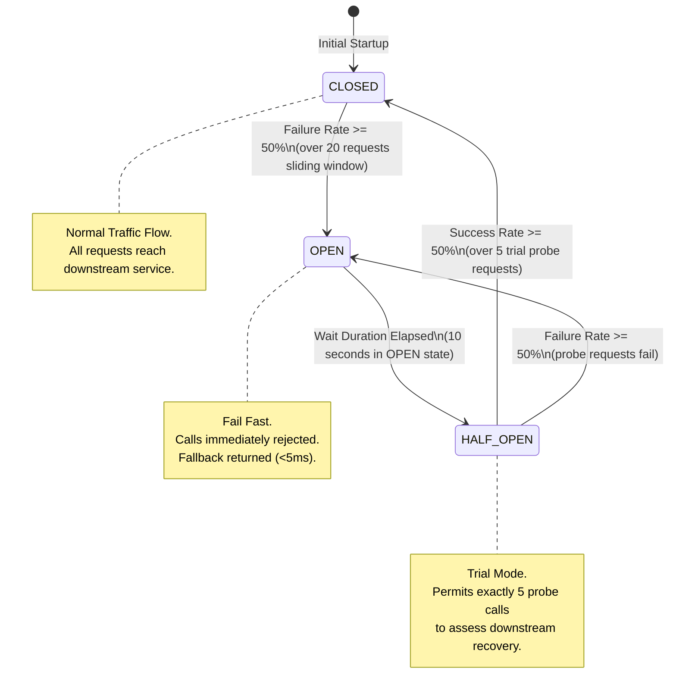

# Circuit Breaker Design Document

**Document Identifier:** DOC-RES-004  
**Traceability References:** NFR-002, NFR-006, ADR-004, DOC-RES-001  
**Technology Baseline:** Resilience4j 2.2.x, Spring Cloud CircuitBreaker  
**Status:** Approved Baseline  

---

## 1. Executive Summary
This document specifies the circuit breaker architecture implemented at the API Gateway and service boundaries. The circuit breaker protects downstream services from cascading failure during outages, prevents resource exhaustion on upstream caller threads, and enables graceful degradation.

---

## 2. Circuit Breaker State Machine



---

## 3. Resilience4j Configuration Specification

Configured in `api-gateway/src/main/resources/application.yml`:

```yaml
resilience4j:
  circuitbreaker:
    configs:
      default:
        sliding-window-type: COUNT_BASED
        sliding-window-size: 20
        minimum-number-of-calls: 10
        failure-rate-threshold: 50.0
        slow-call-rate-threshold: 50.0
        slow-call-duration-threshold: 3000ms
        wait-duration-in-open-state: 10000ms
        permitted-number-of-calls-in-half-open-state: 5
        automatic-transition-from-open-to-half-open-enabled: true
        record-exceptions:
          - java.io.IOException
          - java.util.concurrent.TimeoutException
          - org.springframework.web.client.ResourceAccessException
        ignore-exceptions:
          - com.taskmanager.common.exception.ResourceNotFoundException
          - com.taskmanager.common.exception.ValidationException
    instances:
      taskServiceCircuitBreaker:
        base-config: default
      userServiceCircuitBreaker:
        base-config: default
      notificationServiceCircuitBreaker:
        base-config: default
```

### 3.1 Parameter Rationale
1. **Count-Based Sliding Window (20)**: Small enough to react quickly to an outage (within 10-20 failed calls) without being overly volatile to occasional network hiccups.
2. **50% Failure Threshold**: If 10 of the last 20 calls fail or time out (>3s), the circuit immediately trips to `OPEN`.
3. **10-Second Wait in OPEN**: Gives degraded downstream instances 10 seconds of complete quiet time to recover, clear GC pauses, or reboot.
4. **Exception Classification**: Business 4xx exceptions (like `ValidationException` or `ResourceNotFoundException`) are explicitly ignored by the circuit breaker so client errors do not trip the circuit.

---

## 4. Gateway Circuit Breaker Filter & Fallback Routing

Configured in Spring Cloud Gateway routes:
```yaml
spring:
  cloud:
    gateway:
      routes:
        - id: task-service-route
          uri: lb://TASK-SERVICE
          predicates:
            - Path=/api/v1/tasks/**
          filters:
            - name: CircuitBreaker
              args:
                name: taskServiceCircuitBreaker
                fallbackUri: forward:/fallback/tasks
```

### 4.1 Fallback Controller Implementation
```java
@RestController
@RequestMapping("/fallback")
public class FallbackController {

    @GetMapping("/tasks")
    public ResponseEntity<ProblemDetail> taskServiceFallback() {
        ProblemDetail problem = ProblemDetail.forStatusAndDetail(
                HttpStatus.SERVICE_UNAVAILABLE,
                "Task service is temporarily unavailable. Please retry in a few moments."
        );
        problem.setTitle("Service Unavailable");
        problem.setProperty("errorCode", "SERVICE_TEMPORARILY_UNAVAILABLE");
        problem.setProperty("timestamp", Instant.now().toString());
        return ResponseEntity.status(HttpStatus.SERVICE_UNAVAILABLE).body(problem);
    }
}
```

---

## 5. Metrics and Observability

Resilience4j exposes Prometheus metrics via Micrometer:
- `resilience4j.circuitbreaker.state`: Current state (`0 = CLOSED`, `1 = OPEN`, `2 = HALF_OPEN`).
- `resilience4j.circuitbreaker.calls`: Counter partitioned by kind (`successful`, `failed`, `ignored`, `not_permitted`).
- **Prometheus Alert**: Triggers PagerDuty / Slack warning if `resilience4j_circuitbreaker_state{name=~".*"} == 1` for more than 30 seconds.

