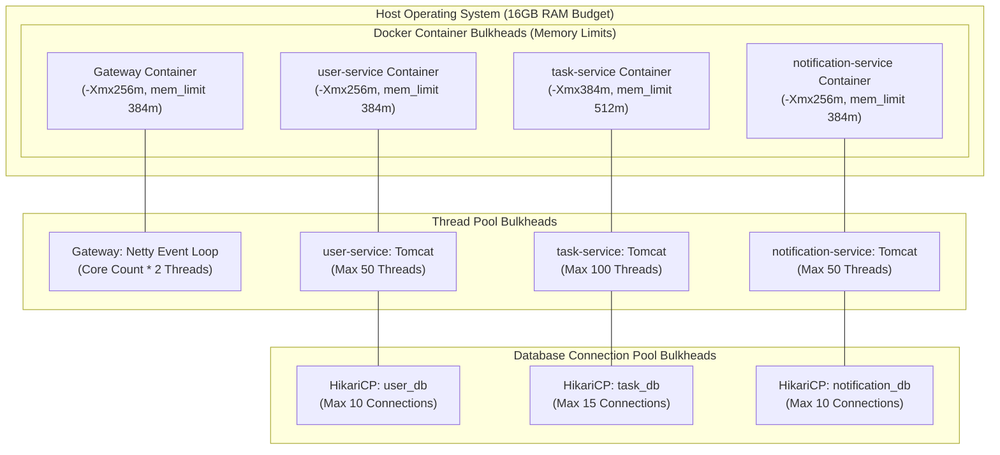

# Bulkhead Pattern Design

**Document Identifier:** DOC-RES-006  
**Traceability References:** NFR-002, NFR-006, DOC-RES-001  
**Target Services:** All Platform Microservices  
**Status:** Approved Baseline  

---

## 1. Executive Summary
This document specifies the bulkhead isolation architecture implemented across thread pools, database connection pools, memory partitions, and consumer concurrency. Borrowed from maritime engineering, bulkheads partition resources into isolated compartments so that resource starvation or failure in one area cannot collapse the broader system.

---

## 2. Bulkhead Architecture Across Tiers



---

## 3. Database Connection Pool Bulkheading

Under the Database-per-Service architecture, each microservice operates a physically isolated `HikariCP` connection pool:

| Service | Dedicated Database | Hikari Max Pool Size | Hikari Min Idle | Isolation Benefit |
|---|---|---|---|---|
| `user-service` | `user_db` | 10 | 5 | Authentication and profile queries are never blocked by heavy task queries. |
| `task-service` | `task_db` | 15 | 5 | Complex multi-predicate task searches cannot starve user logins or notification reads. |
| `notification-service` | `notification_db` | 10 | 5 | Notification ingestion spikes cannot saturate core task CRUD operations. |

> [!NOTE]
> In a shared-database monolith, a slow query on task reporting could lock all 50 pool connections, causing login failures across the application. Bulkheading guarantees complete connection isolation.

---

## 4. Application Thread Pool Bulkheading

Configured in `application.yml`:
```yaml
server:
  tomcat:
    threads:
      max: 100               # Upper ceiling on concurrent HTTP worker threads
      min-spare: 20          # Warm threads ready for traffic bursts
    accept-count: 50         # Operating system socket backlog queue limit
    max-connections: 2000    # Maximum concurrent TCP connections accepted
```

### 4.1 Resilience4j Semaphore Bulkhead on Heavy Endpoints
For computationally or I/O-intensive operations (such as multi-attribute task search with pagination), a semaphore bulkhead restricts concurrent executions to 30:
```yaml
resilience4j:
  bulkhead:
    instances:
      taskSearchBulkhead:
        max-concurrent-calls: 30
        max-wait-duration: 200ms
```
If 30 concurrent searches are active, subsequent callers wait up to 200ms before receiving `HTTP 429` / `503`, safeguarding CPU and heap capacity.

---

## 5. Kafka Consumer Thread Bulkheading

- `notification-service` allocates a dedicated Kafka listener thread pool with `concurrency = 3`.
- Ingestion threads run completely isolated from inbound HTTP Tomcat threads, ensuring heavy message consumption never degrades user-facing REST responsiveness.

