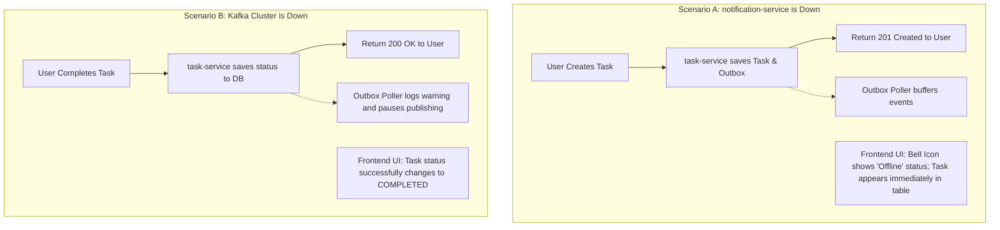

# Graceful Degradation Strategy

**Document Identifier:** DOC-RES-007  
**Traceability References:** NFR-002, NFR-006, DOC-RES-001  
**Target Services:** All Platform Components & React UI  
**Status:** Approved Baseline  

---

## 1. Executive Summary
This document specifies the graceful degradation strategy for the Task Management System. When individual subsystems or background components degrade or fail, the platform sheds non-essential features and serves degraded responses rather than presenting complete failure screens to end users.

---

## 2. Capability Tier Classification

| Tier | Functionality | Criticality | Availability Requirement | Failure Tolerance |
|---|---|---|---|---|
| **Tier 1 (Core / Critical)** | User Registration, Login, Token Issuance, Task CRUD operations | Critical | 99.9% Uptime | Zero Tolerance: Must remain available. |
| **Tier 2 (Supporting)** | Dynamic Filtering, Task Search, Dashboard Metric Aggregations | High | 99.5% Uptime | Moderate: Degrades to default un-filtered list or cached counts. |
| **Tier 3 (Non-Critical)** | Real-time In-App Notifications, Notification History Retrieval | Medium | 99.0% Uptime | High: System functions seamlessly without notifications. |

---

## 3. Graceful Degradation Scenarios & Fallback Behaviors

### 3.1 Scenario 1: `notification-service` Outage
- **Backend Behavior**: `task-service` and `user-service` operate without any awareness of `notification-service`. Task events accumulate in Kafka partition logs until retention expiration (7 days).
- **Gateway Behavior**: Requests to `/api/v1/notifications/**` trip the `notificationServiceCircuitBreaker` and return fallback `HTTP 503` or empty JSON list `[]`.
- **Frontend UI Behavior**:
  - The notification bell icon displays an amber indicator badge with tooltip: *"Notifications temporarily unavailable"*.
  - Task creation, editing, filtering, and deletion continue without disruption or error modals.

### 3.2 Scenario 2: Apache Kafka Broker Outage
- **Backend Behavior**: `task-service` commits tasks to PostgreSQL and writes event envelopes to `outbox_events`. The scheduled outbox poller catches broker connection exceptions, logs a warning, and pauses publishing.
- **Frontend UI Behavior**: User experiences zero degradation; task changes persist with full ACID guarantees.

### 3.3 Scenario 3: Heavy Load on Dashboard Metrics
- **Backend Behavior**: If `/api/v1/tasks/dashboard` experiences high database latency, the endpoint returns cached metric counts from the last 60 seconds.
- **Frontend UI Behavior**: Dashboard shows an informational note: *"Metrics updated 1 min ago"*.

---

## 4. Degraded UI UX Guidelines
1. **Never Show Blank Error Screens**: Application layout, sidebar, navigation header, and main task table remain visible at all times.
2. **Contextual Amber Banners**: Non-blocking toast notifications inform users of degraded background features without intercepting modal workflows.
3. **Optimistic UI Updates**: The frontend immediately reflects task status changes in the local state, synchronizing with the backend in the background.

