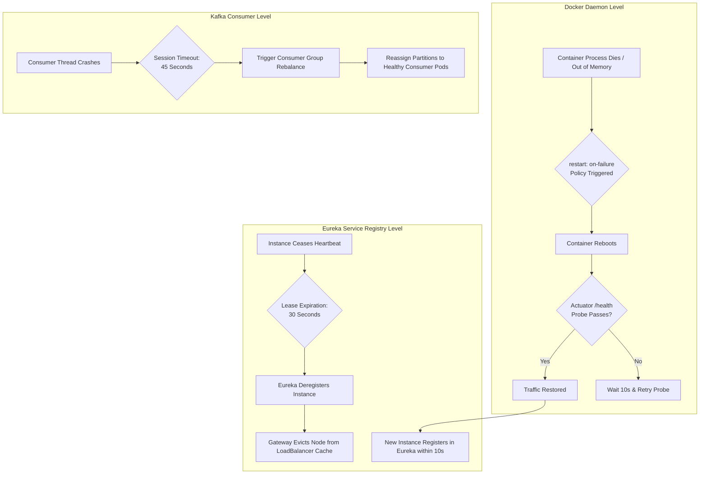

# Failure Recovery Design

**Document Identifier:** DOC-RES-008  
**Traceability References:** NFR-002, NFR-006, DOC-RES-001, ADR-004  
**Target Services:** All Platform Infrastructure & Services  
**Status:** Approved Baseline  

---

## 1. Executive Summary
This document specifies the automated self-healing mechanisms, disaster recovery workflows, and Mean Time to Recovery (MTTR) targets across the Task Management System. The architecture minimizes operational intervention by automating failure detection, container reboot, health probing, and data synchronization.

---

## 2. Automated Self-Healing Mechanisms



---

## 3. MTTR (Mean Time to Recovery) Target SLA Matrix

| Failure Mode | Detection Mechanism | Automated Recovery Action | MTTR Target |
|---|---|---|---|
| **Microservice OOM / Crash** | Docker daemon process exit code | Docker Compose restarts container (`restart: unless-stopped`). | **< 15 seconds** |
| **Microservice Freeze / Deadlock** | Actuator `/actuator/health` probe fails 3 times | Docker healthcheck fails; container restarted. | **< 30 seconds** |
| **Service Instance Deregistration** | Missing Eureka heartbeat (10s interval) | Eureka evicts instance after 30s lease expiration. | **< 30 seconds** |
| **Database Container Crash** | Process termination / port drop | Container restarts; PostgreSQL automatically replays WAL log. | **< 45 seconds** |
| **Kafka Broker Restart** | TCP connection reset | Producer/Consumer auto-reconnect backoff; outbox buffers events. | **< 20 seconds** |
| **Poison Pill Kafka Ingestion** | Deserialization / Processing error | `DefaultErrorHandler` routes to DLT after 3 attempts. | **< 7 seconds** |

---

## 4. Subsystem Recovery Workflows

### 4.1 Database Write-Ahead Log (WAL) Replay
- PostgreSQL operates with `wal_level = replica` and `fsync = on`.
- Following an abrupt power cut or container crash, PostgreSQL enters recovery mode upon restart, scanning the last checkpoint and replaying unwritten transactions from the WAL logs.
- Hibernate and Flyway execute automatic connection retry loops (`hikari.connection-timeout = 3000ms`) until PostgreSQL is fully accepting connections.

### 4.2 Outbox Poller Stalled Event Sweeper
To guard against poller crashes occurring midway through event publication:
- A secondary scheduled task runs every 5 minutes in `task-service`:
  ```sql
  SELECT * FROM outbox_events 
  WHERE processed = FALSE 
    AND created_at < NOW() - INTERVAL '5 minutes'
  FOR UPDATE SKIP LOCKED;
  ```
- Any event stranded in `processed = false` due to a node crash is picked up and published to Kafka.

### 4.3 Kafka Offset Rewind and Consumer Recovery
- When a new `notification-service` consumer container joins the consumer group, Kafka assigns it topic partitions.
- The consumer queries `__consumer_offsets` to identify the last committed offset and resumes message processing without data loss.
- In-flight duplicate deliveries are neutralized by the `consumed_events` idempotency table.

