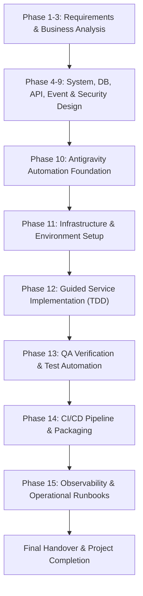

# Antigravity Automation Strategy

**Document Identifier:** DOC-AUTO-001  
**Traceability References:** Master Project Goal, SDLC Governance Baseline  
**Target Audience:** Engineering Leads, AI Agents, Developers, DevOps Leads  
**Status:** Approved Baseline  

---

## 1. Executive Summary
This document establishes the overarching Antigravity AI automation and engineering governance strategy for the Task Management System. The strategy bridges advanced agentic AI capabilities with disciplined software development lifecycle (SDLC) practices. By establishing rigorous agent boundaries, automated quality gates, systematic documentation tracing, and deterministic verification workflows, the platform achieves rapid iteration speed without sacrificing architectural integrity or production reliability.

---

## 2. Core Strategic Pillars

```
┌────────────────────────────────────────────────────────────────────────┐
│                   ANTIGRAVITY AUTOMATION STRATEGY                      │
├─────────────────────┬───────────────────┬──────────────────────────────┤
│ 1. Documentation-   │ 2. Role-Based     │ 3. Automated Quality         │
│    First Discipline │    Specialization │    Gates & CI                │
│ - Zero code before  │ - Multi-persona   │ - Strict DoR & DoD gates     │
│   architecture sign-off│ alignment      │ - 80%+ branch test coverage  │
│ - Living RTM sync   │ - Domain context  │ - Zero high-severity flaws   │
├─────────────────────┼───────────────────┼──────────────────────────────┤
│ 4. Deterministic    │ 5. Bounded Context│ 6. Transparent Tracing       │
│    Verification     │    Isolation      │    & Observability           │
│ - Continuous test   │ - Database-per-   │ - Full session auditability  │
│   execution harness │   service         │ - MDC correlation ID tracing │
│ - Testcontainers    │ - Independent     │ - Actionable review reports  │
│   integration tests │   service builds  │                              │
└─────────────────────┴───────────────────┴──────────────────────────────┘
```

---

## 3. Engineering Automation Lifecycle

The development workflow transitions through structured automated stages:



---

## 4. Agent Execution Framework

1. **Autonomous Operation with Human Verification**: AI agents autonomously execute tasks across specialized phases, creating complete artifacts, source modules, and verification tests. Formal review reports conclude every phase before advancing.
2. **Context Window Management**: Project state is persisted in structured Markdown documentation within the repository (`documentation/`) rather than relying on ephemeral conversation memory.
3. **No Phantom Progress**: Agents must never claim completion of a document, component, or test case without verifying physical disk persistence and syntactic validity.
4. **Failure Transparency**: Any build error, broken test, or unmet constraint must be immediately surfaced in review reports and addressed before proceeding.

