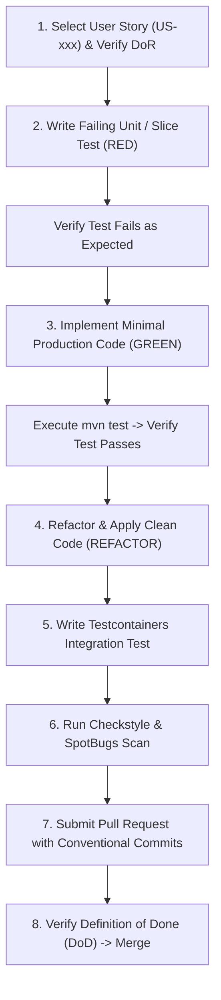

# Automated Development Workflow

**Document Identifier:** DOC-AUTO-004  
**Traceability References:** Master Project Goal, DOC-AUTO-001, DOC-AUTO-002  
**Target Services:** All Backend & Frontend Codebases  
**Status:** Approved Baseline  

---

## 1. Executive Summary
This document specifies the automated, test-driven development (TDD) workflow enforced across the Task Management System. The workflow bridges story ingestion, automated test generation, implementation, static code quality scanning, and peer review.

---

## 2. End-to-End TDD Engineering Workflow



---

## 3. Step-by-Step Execution Protocol

### Step 1: Definition of Ready (DoR) Gate
Before starting implementation:
- Confirm user story has unique ID (`US-xxx`), functional requirement (`FR-xxx`), and acceptance criteria in Given-When-Then format.
- Confirm database schema migrations (Flyway) and API schemas (OpenAPI) are already specified in design documentation.

### Step 2: Red Phase (Test-First)
- Write unit tests in `src/test/java` utilizing JUnit 5, AssertJ, and Mockito.
- Unit tests test business logic in isolation using mock repositories:
  ```java
  @Test
  void shouldThrowNotFound_whenTaskBelongsToAnotherUser() {
      // Given
      UUID taskId = UUID.randomUUID();
      UUID callerId = UUID.randomUUID();
      when(taskRepository.findByIdAndUserIdAndIsDeletedFalse(taskId, callerId))
          .thenReturn(Optional.empty());

      // When & Then
      assertThatThrownBy(() -> taskService.getTaskById(taskId, callerId))
          .isInstanceOf(ResourceNotFoundException.class)
          .hasMessageContaining(taskId.toString());
  }
  ```
- Run `mvn test` to confirm the test fails (Red).

### Step 3: Green Phase (Implementation)
- Implement domain service logic, JPA repository methods, and REST controllers.
- Re-run `mvn test` to confirm test succeeds (Green).

### Step 4: Refactor Phase
- Remove code duplication, extract helper methods, and ensure compliance with Java 21 idiomatic patterns (`record` DTOs, pattern matching).

### Step 5: Integration Testing (Testcontainers)
- Write integration tests using real PostgreSQL and Kafka containers managed via Testcontainers.
- Validate that the outbox record is persisted and event is emitted as expected.

### Step 6: Static Analysis & Local Quality Gates
- Execute Maven verify:
  ```powershell
  mvn clean verify
  ```
- Must produce zero Checkstyle errors, zero SpotBugs high-priority warnings, and 80%+ branch test coverage.

