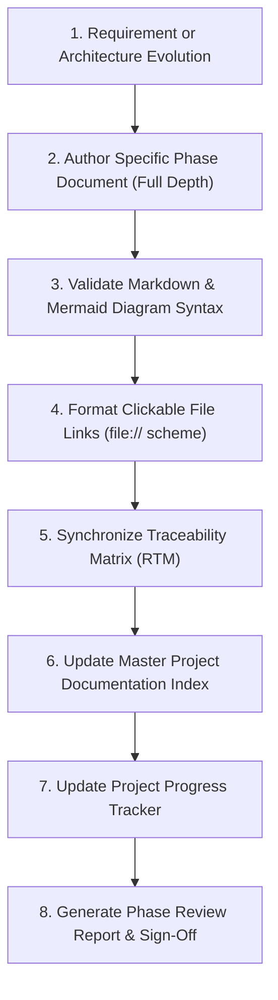

# Documentation Automation Workflow

**Document Identifier:** DOC-AUTO-005  
**Traceability References:** Master Project Goal, DOC-AUTO-001, DOC-AUTO-002  
**Applicability:** All Documentation Artifacts and Registers  
**Status:** Approved Baseline  

---

## 1. Executive Summary
This document specifies the workflow and verification standards for authoring, maintaining, cross-referencing, and synchronizing project documentation across the Task Management System. In a documentation-first architecture, documentation is treated with identical engineering rigor as production source code.

---

## 2. Documentation Governance Lifecycle

---

## 3. Core Automation Protocols

### 3.1 Traceability Synchronization (`requirements-traceability-matrix.md`)
Whenever an API endpoint, database table, Kafka event, or test case is designed or modified:
1. Locate the parent requirement ID (`BR-xxx`, `FR-xxx`, `NFR-xxx`).
2. Update the corresponding row in `requirements-traceability-matrix.md`.
3. Verify that forward and backward traceability remain contiguous.

### 3.2 Index Synchronization (`project-documentation-index.md`)
1. Every newly created document must be cataloged in `documentation/project-documentation-index.md` with:
   - Unique Document ID (`DOC-XXX-yyy`).
   - Full human-readable Title.
   - Clickable `file://` hyperlink.
   - Semantic Version (`1.0.0`).
   - Status (`Planned` $\rightarrow$ `In Progress` $\rightarrow$ `Approved Baseline`).
   - Related Requirement IDs.

### 3.3 Progress Tracking (`project-progress.md`)
1. Upon completing a document, increment the `Docs Completed` counter for the active phase.
2. Calculate overall completion percentage:
   $$\text{Progress} = \frac{\text{Completed Documents}}{\text{Total Planned Documents}} \times 100\%$$
3. Update the `Current Active Phase` and `Next Action` pointers.

---

## 4. Documentation Formatting & Quality Standards

1. **Standard Markdown & GitHub Flavored Markdown (GFM)**:
   - Use standard headers (`#`, `##`, `###`), tables, and code fences.
   - Use GitHub-style alerts (`> [!NOTE]`, `> [!WARNING]`, `> [!IMPORTANT]`, `> [!TIP]`, `> [!CAUTION]`) strategically.
2. **Mermaid Diagram Validation**:
   - Use only supported types: `flowchart TD/LR`, `sequenceDiagram`, `stateDiagram-v2`, `classDiagram`, `erDiagram`.
   - Quote node labels containing parentheses or brackets (e.g. `id["Label (Extra Info)"]`).
   - Avoid raw HTML tags inside node labels.
3. **Hyperlink Standards**:
   - Use clickable markdown links with `file:///` scheme and forward slashes on Windows:
     `[task-service](file:///d:/learning/task_manager/task-service)`
4. **Drift Prevention**:
   - Code changes that deviate from documented architectural baselines are rejected in code review until an accompanying ADR or document update is approved.

