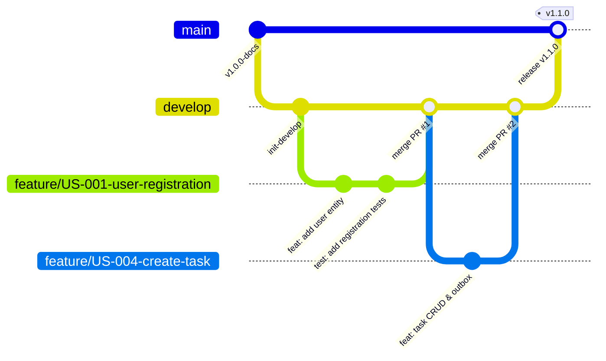

# Git Branching Strategy

**Document Identifier:** DOC-AUTO-011  
**Traceability References:** Master Project Baseline, DOC-AUTO-001, DOC-AUTO-004  
**Workflow Model:** GitHub Flow with Protected Long-Lived Branches  
**Status:** Approved Baseline  

---

## 1. Executive Summary
This document establishes the Git branching strategy, branch naming conventions, merge policies, and release workflows for the Task Management System repository (`https://github.com/ezhilselvan1109/task_manager`).

---

## 2. Git Branching Model

---

## 3. Branch Taxonomy and Naming Conventions

| Branch Category | Branch Prefix / Pattern | Source Branch | Merge Target | Example |
|---|---|---|---|---|
| **Production** | `main` | - | - | `main` (Protected) |
| **Development** | `develop` | `main` | `main` | `develop` (Protected) |
| **Feature** | `feature/US-{id}-{slug}` | `develop` | `develop` | `feature/US-004-create-task` |
| **Bugfix** | `bugfix/{id}-{slug}` | `develop` | `develop` | `bugfix/BUG-012-date-parse` |
| **Hotfix** | `hotfix/v{version}-{slug}` | `main` | `main` & `develop` | `hotfix/v1.0.1-jwt-secret-bug` |
| **Documentation**| `docs/phase-{phase}-{slug}` | `develop` | `develop` | `docs/phase-10-antigravity-auto`|

---

## 4. Protected Branch Governance Rules

### 4.1 Protected `main` & `develop` Policies
1. **Direct Push Blocked**: Nobody (including repository administrators) can push directly to `main` or `develop`. All changes must arrive via a Pull Request.
2. **Mandatory Status Checks**:
   - Jenkins CI pipeline must complete GREEN (`build-and-test`).
   - Static analysis (`checkstyle`, `spotbugs`) must pass with 0 errors.
   - Branch test coverage must satisfy the 80% threshold.
3. **Mandatory Review Approvals**:
   - At least **1 peer review approval** from a Senior Engineer or Architect.
   - All conversation threads in the PR review must be resolved.
4. **Merge Method**:
   - **Squash and Merge** is mandated for feature and bugfix PRs to ensure a linear, high-signal commit history on `develop` and `main`.
   - The head branch is automatically deleted upon merge.

