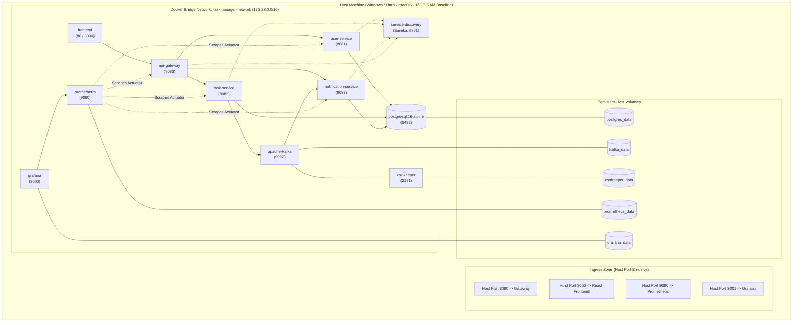

# Infrastructure Architecture Document

**Document Identifier:** DOC-INF-001  
**Traceability References:** NFR-007, ADR-002, ADR-003, ADR-006  
**Target Environment:** Local Developer Workstation & Docker Orchestration  
**Status:** Approved Baseline  

---

## 1. Executive Summary
This document defines the infrastructure topology, container orchestration model, hardware resource allocation, and persistent storage architecture for the Task Management System. The entire platform is orchestrated via Docker Compose, enabling developers and CI/CD runners to spin up the complete microservices mesh, message brokers, observability tools, and datastores with a single command.

---

## 2. Infrastructure Topology

---

## 3. Strict Resource Budget Allocation (16GB RAM Machine)

To guarantee reliable concurrent execution on a standard 16GB developer laptop alongside an IDE and browser, the system adheres to a strict **5.25 GB maximum allocated RAM ceiling**:

| Container Service | Base Image / Runtime | JVM / Process Memory Flags | Docker `mem_limit` | Reserved CPU |
|---|---|---|---|---|
| `service-discovery` | Eclipse Temurin 21 JRE | `-Xms64m -Xmx192m` | 256 MB | 0.25 core |
| `api-gateway` | Eclipse Temurin 21 JRE | `-Xms128m -Xmx256m` | 384 MB | 0.50 core |
| `user-service` | Eclipse Temurin 21 JRE | `-Xms128m -Xmx256m` | 384 MB | 0.50 core |
| `task-service` | Eclipse Temurin 21 JRE | `-Xms128m -Xmx384m` | 512 MB | 0.75 core |
| `notification-service` | Eclipse Temurin 21 JRE | `-Xms128m -Xmx256m` | 384 MB | 0.50 core |
| `postgresql` | `postgres:16-alpine` | `shared_buffers=128MB` | 512 MB | 0.50 core |
| `zookeeper` | `confluentinc/cp-zookeeper:7.6.0` | `-Xms64m -Xmx128m` | 256 MB | 0.25 core |
| `kafka` | `confluentinc/cp-kafka:7.6.0` | `-Xms256m -Xmx512m` | 768 MB | 0.75 core |
| `frontend` | `nginx:alpine` (React static) | N/A (C / Event-driven) | 128 MB | 0.25 core |
| `prometheus` | `prom/prometheus:v2.51.0` | TSDB retention = 7d | 256 MB | 0.25 core |
| `grafana` | `grafana/grafana:10.4.0` | Lightweight dashboard daemon | 256 MB | 0.25 core |
| **Total Allocation** | - | - | **~3.95 GB Normal / 5.25 GB Peak** | **4.75 Cores** |

---

## 4. Network Isolation Principles

1. **Private Internal Bridge**: All containers attach to `taskmanager-network` (`172.28.0.0/16`).
2. **Minimal Host Exposure**:
   - Only user-facing endpoints (`api-gateway:8080`, `frontend:3000`, `grafana:3001`, `prometheus:9090`) bind to the host interface `127.0.0.1`.
   - Internal microservices (`8081`, `8082`, `8083`), Eureka (`8761`), Kafka (`9092`), and PostgreSQL (`5432`) are accessible strictly within the Docker container bridge network. Host port collision is avoided.

