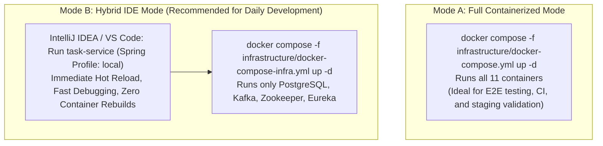

# Local Environment Configuration

**Document Identifier:** DOC-INF-003  
**Traceability References:** NFR-007, DOC-INF-001  
**Target Environments:** Full Containerized Mode, Hybrid IDE Mode  
**Status:** Approved Baseline  

---

## 1. Executive Summary
This document specifies the local development execution modes and Spring profiles supported by the Task Management platform. Developers can toggle seamlessly between **Full Containerized Mode** (all services in Docker) and **Hybrid IDE Mode** (infrastructure in Docker, active service in IDE with hot-reload and breakpoint debugging).

---

## 2. Developer Operational Modes



---

## 3. Spring Profile Taxonomy

Each microservice implements three standardized Spring application profiles:

| Profile Name | Active Configuration File | Target Environment | Database URL | Eureka Discovery URL | Kafka Bootstrap |
|---|---|---|---|---|---|
| `docker` | `application-docker.yml` | Container runtime | `jdbc:postgresql://postgresql:5432/task_db` | `http://service-discovery:8761/eureka` | `kafka:9092` |
| `local` | `application-local.yml` | Developer IDE | `jdbc:postgresql://localhost:5432/task_db` | `http://localhost:8761/eureka` | `localhost:9094` |
| `test` | `application-test.yml` | JUnit Test Suites | Dynamic Testcontainers URL | In-Memory Stub | Dynamic Testcontainers |

---

## 4. Hybrid Infrastructure Port Forwarding

In Hybrid Mode, `docker-compose-infra.yml` exposes host ports for local IDE processes to bind directly:

| Infrastructure Service | Container Internal Port | Exposed Host Port (Hybrid Mode) |
|---|---|---|
| **PostgreSQL** | `5432` | `localhost:5432` |
| **Apache Kafka** | `9092` (internal) | `localhost:9094` (external host listener) |
| **Zookeeper** | `2181` | `localhost:2181` |
| **Eureka Discovery** | `8761` | `localhost:8761` |

### 4.1 Running a Single Service in IDE
To run `task-service` locally in Hybrid Mode:
1. Start infrastructure:
   ```powershell
   docker compose -f infrastructure/docker-compose-infra.yml up -d
   ```
2. In IntelliJ, add VM Option / Environment Variable:
   ```properties
   spring.profiles.active=local
   ```
3. Run `TaskServiceApplication.java`. The service connects to PostgreSQL on `localhost:5432`, Kafka on `localhost:9094`, and registers with Eureka on `localhost:8761`.

