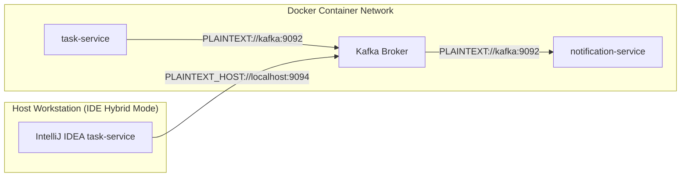

# Apache Kafka Infrastructure Design

**Document Identifier:** DOC-INF-010  
**Traceability References:** ADR-001, NFR-007, DOC-INF-005  
**Messaging Stack:** Apache Kafka 3.7+ (Confluent Platform 7.6.0)  
**Status:** Approved Baseline  

---

## 1. Executive Summary
This document specifies the Apache Kafka and Zookeeper broker infrastructure supporting the event-driven messaging architecture. The broker runs in single-node mode locally, optimized for developer workstations while maintaining multi-partition topic topologies and dual listener configurations for hybrid IDE execution.

---

## 2. Broker Listener Configuration (Dual Listener Strategy)

To allow both internal Docker containers and local developer IDE processes to connect to Kafka, two distinct listeners are configured:

```yaml
KAFKA_LISTENER_SECURITY_PROTOCOL_MAP: PLAINTEXT:PLAINTEXT,PLAINTEXT_HOST:PLAINTEXT
KAFKA_ADVERTISED_LISTENERS: PLAINTEXT://kafka:9092,PLAINTEXT_HOST://localhost:9094
```



---

## 3. Automated Topic Provisioning Script

A lightweight initialization container (`kafka-init`) automatically runs on initial Docker Compose startup to create platform topics with exact partition counts and retention policies:

```yaml
kafka-init:
  image: confluentinc/cp-kafka:7.6.0
  depends_on:
    kafka:
      condition: service_healthy
  networks:
    - taskmanager-network
  entrypoint: [ "sh", "-c" ]
  command: |
    "
    # Create main task events topic with 3 partitions
    kafka-topics --bootstrap-server kafka:9092 --create --if-not-exists \
      --topic task.events.v1 --partitions 3 --replication-factor 1 \
      --config retention.ms=604800000 --config cleanup.policy=delete

    # Create Dead Letter Topic with 3 partitions
    kafka-topics --bootstrap-server kafka:9092 --create --if-not-exists \
      --topic task.events.v1.DLT --partitions 3 --replication-factor 1 \
      --config retention.ms=1209600000 --config cleanup.policy=delete

    echo 'Kafka topics provisioned successfully.'
    "
```

---

## 4. Broker Storage and Resource Allocation

- **Memory Limit**: 768 MB (JVM Heap: `-Xms256m -Xmx512m`).
- **Disk Persistence**: `kafka_data:/var/lib/kafka/data`.
- **Retention Period**: 7 days (604,800,000 ms) for `task.events.v1`; 14 days (1,209,600,000 ms) for `task.events.v1.DLT` to give operators sufficient time to triage poison pills.

