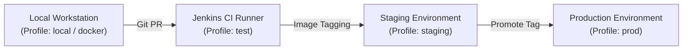

# Environment Separation Strategy

**Document Identifier:** DOC-INF-012  
**Traceability References:** NFR-007, DOC-INF-001, Twelve-Factor App Parity  
**Target Environments:** Local, CI/CD, Staging, Production  
**Status:** Approved Baseline  

---

## 1. Executive Summary
This document specifies the environment separation framework and configuration promotion strategy across the Task Management platform. In compliance with the Twelve-Factor App methodology, codebase parity is strictly maintained across all environments, with differences restricted solely to externalized environment variables and scaling topologies.

---

## 2. Environment Parity Matrix

| Architecture Dimension | Local Development | CI / Jenkins Pipeline | Staging (Pre-Prod) | Production (Target Baseline) |
|---|---|---|---|---|
| **Orchestrator** | Docker Compose v2 | Docker Engine / Testcontainers | Docker Swarm / K8s | Kubernetes / Managed Cluster |
| **PostgreSQL Topology** | Single container, 3 databases | Disposable Testcontainer | Primary + Read Replica | Highly Available PostgreSQL Cluster |
| **Kafka Topology** | 1 Broker, 1 Zookeeper | Testcontainers Kafka | 3 Brokers, 3 Partitions | 3+ Brokers, Min. ISR = 2 |
| **Discovery Tier** | Single Eureka container | Stubbed / Embedded | 2 Clustered Eureka nodes | Clustered Eureka / K8s DNS |
| **Secrets Management** | `.env` file (git-ignored) | Jenkins Credentials Store | HashiCorp Vault | HashiCorp Vault / Cloud Secrets |
| **TLS / SSL** | HTTP on localhost | Plain HTTP internal | TLS terminated at Gateway | Strict HTTPS + HSTS |
| **Log Level** | `DEBUG` / `INFO` | `INFO` | `WARN` / `INFO` (Structured JSON)| `INFO` / `WARN` with Masking |
| **Rate Limiting** | In-memory Token Bucket | Disabled during tests | Gateway Redis / In-memory | Gateway Distributed Rate Limiter |

---

## 3. Configuration Promotion Rules

1. **Immutable Artifacts**: The exact same Docker image built during the CI pipeline is promoted through Staging to Production. Images are never recompiled between environments.
2. **Externalized Config**: All environment-specific values (database credentials, URLs, JWT secrets) are injected strictly via runtime environment variables.
3. **No Code Branching by Environment**: Code containing `if (env == "production")` is strictly prohibited. Behavior variations are driven entirely by Spring Profiles and externalized configuration properties.

