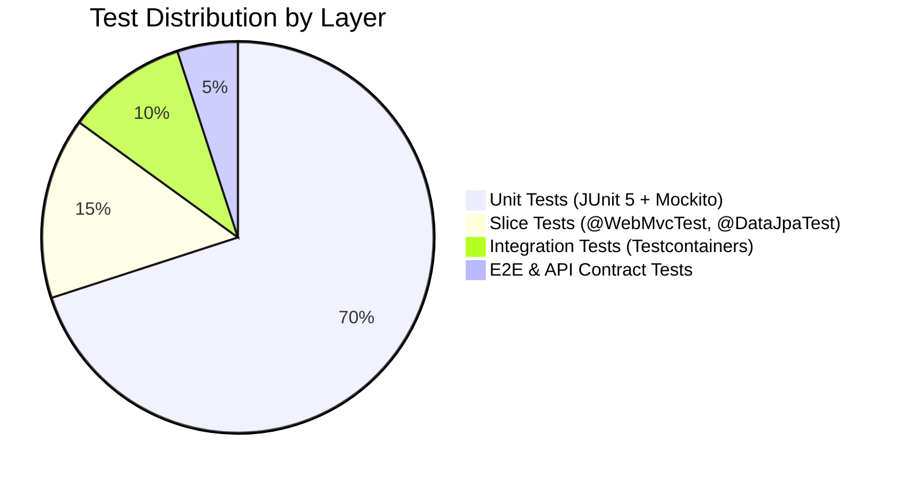

# Test Strategy Document

**Document Identifier:** DOC-TEST-001  
**Traceability References:** NFR-001 to NFR-010, DOC-AUTO-007  
**Quality Standard:** Shift-Left, Multi-Layered Quality Verification  
**Status:** Approved Baseline  

---

## 1. Executive Summary
This document defines the overarching testing strategy for the Task Management Microservices platform. Built upon the principles of shift-left testing, test automation, and behavioral verification (BDD), the strategy ensures that every functional and non-functional requirement is continuously verified throughout the SDLC.

---

## 2. Testing Principles and Objectives

1. **Shift-Left Quality Verification**: Testing begins during requirement and design phases, not after coding. Acceptance criteria dictate test cases before code is written (TDD).
2. **Defect Prevention over Defect Detection**: Comprehensive unit and slice testing catch logic errors within milliseconds on local developer workstations.
3. **Strict Bounded Context Isolation**: Unit tests test services in pure isolation using Mockito; integration tests test inter-component boundaries using real PostgreSQL and Kafka instances via Testcontainers.
4. **Zero Tolerance for Multi-Tenant Data Leakage**: Automated security test suites explicitly probe for IDOR and cross-tenant enumeration vulnerabilities on every build.

---

## 3. Testing Pyramid Distribution

| Layer | Primary Framework | Target Execution Speed | Coverage Goal | Failure Action |
|---|---|---|---|---|
| **Unit** | JUnit 5, Mockito, AssertJ | $< 10$ ms per test | $\ge 80\%$ Line, $\ge 75\%$ Branch | Aborts local compile |
| **Slice** | `@WebMvcTest`, `@DataJpaTest` | $< 200$ ms per test | 100% of REST Controllers | Aborts Maven build |
| **Integration**| Testcontainers (PostgreSQL, Kafka)| $< 5$ s per test suite | 100% of Outbox & Consumers | Fails PR Quality Gate |
| **Contract** | Spring Cloud Contract | $< 1$ s per contract | 100% of Service APIs | Fails CI build |
| **E2E / Security**| REST-Assured, Newman | $< 30$ s total suite | All primary user journeys | Blocks release promote |

---

## 4. Scope of Testing

### 4.1 In-Scope
- User authentication, JWT issuance, validation, and lifecycle.
- Task CRUD, status state machine transitions, priority assignments.
- Search, dynamic filtering, sorting, and pagination.
- Anti-enumeration resource concealment (`404 Not Found` for foreign IDs).
- Transactional Outbox persistence and scheduled publishing.
- Consumer deduplication and idempotent processing.
- Dead Letter Topic routing for malformed payloads.
- Circuit breaker tripping under simulated downstream failure.
- API Gateway rate limiting (Token Bucket).

### 4.2 Out-of-Scope (Deferred Post-MVP)
- Mobile native application testing (iOS/Android).
- Multi-region geo-distributed latency testing.
- Hardware physical disaster recovery simulation.

