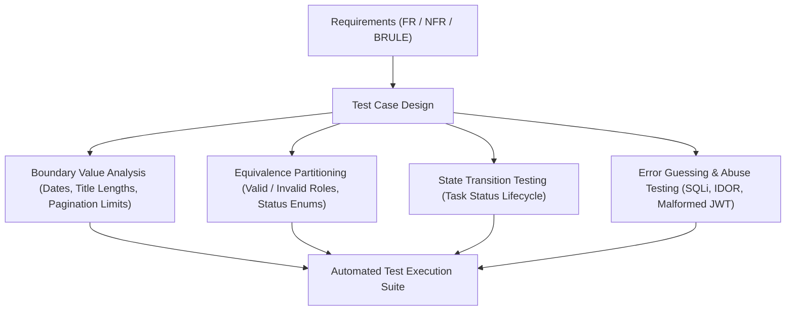

# Master Test Plan

**Document Identifier:** DOC-TEST-002  
**Standard Compliance:** IEEE 829-2008 Standard for Software Test Documentation  
**Traceability References:** BR-001 to BR-010, FR-001 to FR-020, NFR-001 to NFR-010  
**Status:** Approved Baseline  

---

## 1. Test Items & Architectural Scope
The Master Test Plan encompasses the following deployable artifacts across the repository:
1. `api-gateway`: Route forwarding, JWT filter, header sanitization, rate limiting, circuit breaker.
2. `user-service`: User registration, BCrypt hashing, JWT issuance, profile management.
3. `task-service`: Task CRUD, dynamic criteria search, pagination, transactional outbox.
4. `notification-service`: Kafka event consumption, deduplication table, notification retrieval.
5. `service-discovery`: Eureka registration, heartbeat renewal, instance eviction.
6. `frontend`: React SPA, authentication state, task board, filter controls.

---

## 2. Test Approach and Techniques

---

## 3. Item Pass / Fail Criteria

| Test Level | Pass Criteria | Mandatory Action on Failure |
|---|---|---|
| **Unit Tests** | 100% tests pass; zero assertions failed; $\ge 80\%$ line coverage. | Build fails; PR blocked. |
| **Integration Tests** | All database transactions and Kafka message flows commit cleanly. | Build fails; PR blocked. |
| **Security Tests** | Cross-tenant access returns `HTTP 404`; zero plaintext credentials. | Critical Sev-1 logged; merge blocked. |
| **Performance Tests** | p95 latency $< 200$ ms under 100 concurrent virtual users. | Quality warning; performance triage. |

---

## 4. Suspension and Resumption Criteria
- **Suspension Criteria**: If the database schema fails migration (Flyway checksum mismatch) or the Docker container runtime fails to start, all integration and E2E testing is suspended immediately.
- **Resumption Criteria**: Testing resumes once the Flyway script or Docker Compose configuration is fixed and validated locally.

---

## 5. Test Responsibilities Matrix

| Role | Responsibilities | Assigned Tools |
|---|---|---|
| **Developers / Agents** | Unit testing, WebMvc slice testing, TDD implementation | JUnit 5, Mockito, AssertJ |
| **QA Lead / Automation** | Integration testing, contract tests, E2E regression, Testcontainers | Testcontainers, REST-Assured, Newman |
| **Security Architect** | IDOR probing, token tampering, OWASP vulnerability scans | OWASP ZAP, Postman Security Tests |
| **DevOps Lead** | CI/CD test execution pipeline, JaCoCo quality gate enforcement | Jenkins, Docker, SonarQube |

