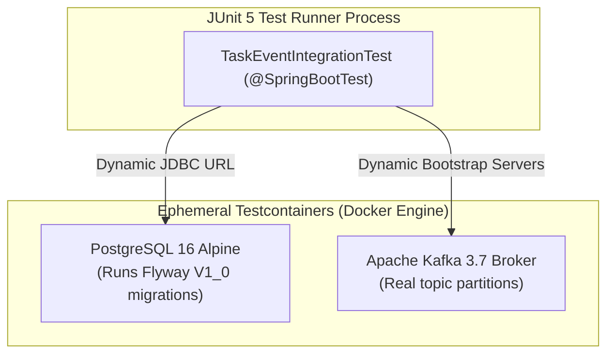

# Integration Testing Strategy

**Document Identifier:** DOC-TEST-006  
**Traceability References:** DOC-AUTO-007, DOC-TEST-001  
**Harness:** Spring Boot Test, Testcontainers (PostgreSQL 16, Apache Kafka 3.7)  
**Status:** Approved Baseline  

---

## 1. Executive Summary
This document specifies the integration testing architecture across the Task Management platform. Integration tests validate real cross-component interactions—including database migrations, JPA specifications, outbox persistence, and Kafka event consumption—against real containerized infrastructure managed by Testcontainers.

---

## 2. Testcontainers Architectural Model



---

## 3. Reference Integration Test (`TaskOutboxIntegrationTest.java`)

```java
@SpringBootTest(webEnvironment = SpringBootTest.WebEnvironment.RANDOM_PORT)
@Testcontainers
class TaskOutboxIntegrationTest {

    @Container
    static PostgreSQLContainer<?> postgres = new PostgreSQLContainer<>("postgres:16-alpine")
            .withDatabaseName("task_db")
            .withUsername("task_app")
            .withPassword("secret");

    @Container
    static KafkaContainer kafka = new KafkaContainer(
            DockerImageName.parse("confluentinc/cp-kafka:7.6.0"));

    @DynamicPropertySource
    static void configureProperties(DynamicPropertyRegistry registry) {
        registry.add("spring.datasource.url", postgres::getJdbcUrl);
        registry.add("spring.datasource.username", postgres::getUsername);
        registry.add("spring.datasource.password", postgres::getPassword);
        registry.add("spring.kafka.bootstrap-servers", kafka::getBootstrapServers);
        registry.add("eureka.client.enabled", () -> "false");
    }

    @Autowired
    private TaskService taskService;

    @Autowired
    private OutboxEventRepository outboxRepository;

    @Autowired
    private TaskRepository taskRepository;

    @Test
    @DisplayName("Should persist task and outbox event atomically in PostgreSQL")
    void createTask_PersistsTaskAndOutboxAtomically() {
        UUID userId = UUID.randomUUID();
        CreateTaskRequest request = new CreateTaskRequest("Integration Test Task", "Verify Outbox", TaskPriority.HIGH, null);

        TaskResponse response = taskService.createTask(request, userId);

        assertThat(response).isNotNull();
        assertThat(taskRepository.existsById(response.id())).isTrue();

        // Verify outbox record was created with status PENDING and processed = false
        List<OutboxEventEntity> outboxList = outboxRepository.findAll();
        assertThat(outboxList).hasSize(1);
        assertThat(outboxList.get(0).getAggregateId()).isEqualTo(response.id());
        assertThat(outboxList.get(0).isProcessed()).isFalse();
        assertThat(outboxList.get(0).getEventType()).isEqualTo("TASK_CREATED");
    }
}
```

