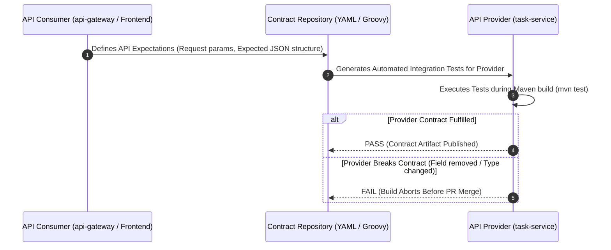

# Contract Testing Strategy

**Document Identifier:** DOC-TEST-008  
**Traceability References:** DOC-API-003, DOC-API-005, DOC-TEST-001  
**Methodology:** Consumer-Driven Contract Testing (Spring Cloud Contract / Pact)  
**Status:** Approved Baseline  

---

## 1. Executive Summary
This document specifies the Consumer-Driven Contract (CDC) testing strategy across the Task Management platform. Contract testing verifies that API providers (`task-service`, `user-service`) satisfy the structural expectations of API consumers (`api-gateway`, React frontend) without requiring full end-to-end environment deployment.

---

## 2. Consumer-Driven Contract Workflow



---

## 3. Sample Contract Specification (`task-service-get-task.yml`)

```yaml
description: "Verify that task-service returns valid TaskResponse DTO"
request:
  method: GET
  url: /api/v1/tasks/3fa85f64-5717-4562-b3fc-2c963f66afa6
  headers:
    X-User-Id: "a1b2c3d4-e5f6-7890-abcd-ef1234567890"
response:
  status: 200
  headers:
    Content-Type: application/json
  body:
    id: "3fa85f64-5717-4562-b3fc-2c963f66afa6"
    userId: "a1b2c3d4-e5f6-7890-abcd-ef1234567890"
    title: "Contract Verification Task"
    status: "TODO"
    priority: "HIGH"
  matchers:
    body:
      - path: $.id
        type: by_regex
        value: "^[0-9a-fA-F-]{36}$"
      - path: $.status
        type: by_regex
        value: "^(TODO|IN_PROGRESS|COMPLETED|CANCELLED)$"
```

