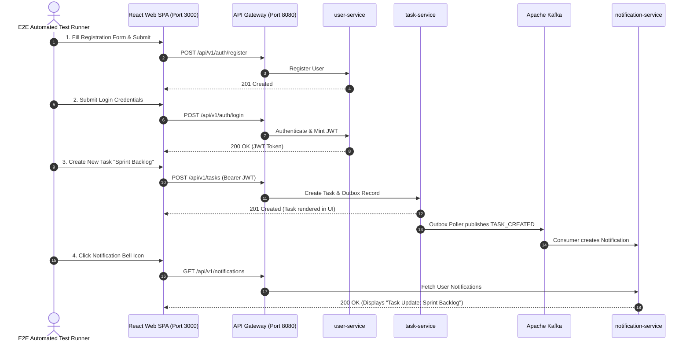

# End-to-End (E2E) Testing Strategy

**Document Identifier:** DOC-TEST-011  
**Traceability References:** US-001 to US-016, DOC-TEST-003, DOC-TEST-001  
**Harnesses:** Cypress / Playwright (Web UI), Postman Newman (API Mesh)  
**Status:** Approved Baseline  

---

## 1. Executive Summary
This document specifies the End-to-End (E2E) testing strategy for validating complete user journeys across the Task Management platform. E2E tests execute against the fully orchestrated Docker Compose environment, verifying real browser interactions and end-to-end API mesh communications.

---

## 2. Core E2E User Journey Flow



---

## 3. Postman Newman Automated Mesh Suite

The API E2E regression suite executes during Jenkins staging verification via Newman:

```bash
newman run tests/e2e/task-manager-mesh.postman_collection.json \
  --environment tests/e2e/local.postman_environment.json \
  --reporters cli,junit \
  --reporter-junit-export target/newman-results.xml
```

- **Validation Checks**:
  1. Complete auth handshake and token extraction.
  2. Sequential task mutations (`TODO` $\rightarrow$ `IN_PROGRESS` $\rightarrow$ `COMPLETED`).
  3. Dashboard metric counters reflect updated tallies.
  4. Cross-tenant request receives `HTTP 404 Not Found`.

