# Resilience Testing Strategy

**Document Identifier:** DOC-TEST-014  
**Traceability References:** NFR-002, NFR-006, DOC-RES-001, DOC-RES-004  
**Testing Methodology:** Chaos Engineering & Fault Injection  
**Status:** Approved Baseline  

---

## 1. Executive Summary
This document specifies the resilience testing procedures, chaos fault injection simulations, and self-healing verifications across the Task Management platform. Resilience tests validate that the system contains failures gracefully and recovers automatically without manual human intervention.

---

## 2. Fault Injection Test Scenarios

```mermaid
graph TD
    subgraph "Chaos Simulation 1: Downstream Outage"
        KillTask["docker stop taskmanager-task-service"] --> Blast["Fire 20 HTTP Requests to /api/v1/tasks"]
        Blast --> VerifyCB["Verify Gateway trips Circuit Breaker to OPEN\nReturns 503 Fallback in < 5ms"]
        VerifyCB --> StartTask["docker start taskmanager-task-service"]
        StartTask --> WaitProbe["Wait 10s wait-duration -> Half-Open Probes Succeed"]
        WaitProbe --> Recovered["Circuit Breaker Resumes CLOSED State"]
    end

    subgraph "Chaos Simulation 2: Kafka Broker Dropped"
        KillKafka["docker stop taskmanager-kafka"] --> CreateTask["POST /api/v1/tasks"]
        CreateTask --> VerifyACID["Verify 201 Created returned\nTask & Outbox record persisted in PostgreSQL"]
        VerifyACID --> StartKafka["docker start taskmanager-kafka"]
        StartKafka --> VerifyPoller["Outbox Poller automatically publishes buffered events"]
    end
```

---

## 3. Resilience Automated Test Verification Matrix

| Chaos Fault Injected | Target Component | Expected System Behavior | Success Criteria |
|---|---|---|---|
| **Downstream Crash** | `task-service` | Gateway circuit breaker trips to `OPEN`. | Subsequent calls fail fast ($< 5$ ms) with `HTTP 503`; zero thread pool exhaustion on Gateway. |
| **Broker Outage** | Apache Kafka | `task-service` continues processing task CRUD. | Tasks committed to PostgreSQL; outbox records wait in `processed = false`; zero user errors. |
| **Database Network Drop**| PostgreSQL | HikariCP aborts calls after 3s connection timeout. | Returns RFC 7807 `503 Service Unavailable`; self-heals automatically when DB reconnects. |
| **Poison Pill Payload** | `notification-service`| Consumer error handler retries 3 times, then isolates to DLT. | Poison pill routed to `task.events.v1.DLT`; consumer group offset commits; queue continues moving. |

