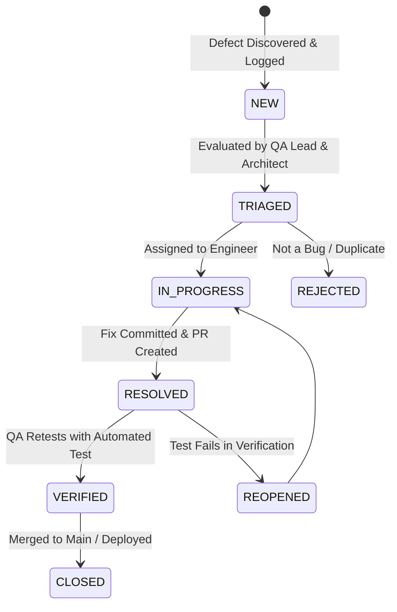

# Defect Management Strategy

**Document Identifier:** DOC-TEST-016  
**Traceability References:** DOC-TEST-001, DOC-TEST-002  
**Governance Framework:** Defect Triage, Severity Classification, Resolution SLA  
**Status:** Approved Baseline  

---

## 1. Executive Summary
This document specifies the defect management lifecycle, severity classification matrix, resolution SLA targets, and reporting templates across the Task Management platform.

---

## 2. Defect Lifecycle State Machine



---

## 3. Severity Classification and Resolution SLAs

| Severity Level | Definition & Business Impact | Examples | Resolution SLA | Release Impact |
|---|---|---|---|---|
| **Sev-1 (Critical)** | Multi-tenant data leakage (IDOR), service crash, security vulnerability, data loss. | Querying another user's task returns 200; JWT secret leaked. | **$< 4$ hours** | Immediate emergency hotfix; halts all releases. |
| **Sev-2 (Major)** | Primary feature non-functional; no viable workaround available. | Task creation throws 500 error; login fails for valid users. | **$< 24$ hours** | Blocks sprint release until resolved. |
| **Sev-3 (Moderate)**| Secondary feature failure; functional workaround exists. | Notification bell badge count delayed; date format inconsistent. | **$< 5$ days** | Scheduled in active sprint backlog. |
| **Sev-4 (Minor)** | Minor cosmetic defect, UI misalignment, typo. | Button padding off by 2px in mobile view; typo in problem detail. | Next sprint | Addressed during routine UI polish. |

---

## 4. Standard Defect Report Template

```markdown
### Defect ID: BUG-xxx
**Title:** [Brief, descriptive summary of the defect]  
**Severity:** Sev-1 / Sev-2 / Sev-3 / Sev-4  
**Target Service:** `api-gateway` / `task-service` / `user-service` / `frontend`  
**Linked Requirements:** FR-xxx, US-xxx, TC-xxx  

#### 1. Description & Preconditions
Detailed narrative of the unexpected behavior and initial system state.

#### 2. Steps to Reproduce
1. Log in as User A.
2. Issue POST /api/v1/tasks with payload {...}
3. Observe error response.

#### 3. Expected vs Actual Result
- **Expected:** Returns 201 Created with task details.
- **Actual:** Returns 500 Internal Server Error with DB lock timeout.

#### 4. Logs & Traceability
- Correlation ID: `a8b3c-912f`
- Stack trace / Screenshot attached.
```

