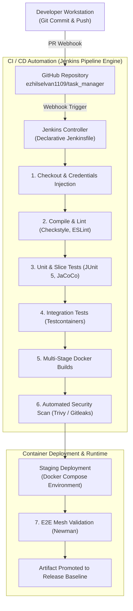

# DevOps Architecture Document

**Document Identifier:** DOC-OPS-001  
**Traceability References:** NFR-007, ADR-003, DOC-AUTO-001  
**Core Stack:** Git, GitHub, Jenkins, Docker, Docker Compose, Maven, Node.js  
**Status:** Approved Baseline  

---

## 1. Executive Summary
This document defines the overarching DevOps architecture, CI/CD toolchain, automation pipelines, and deployment topology for the Task Management System. The architecture automates compilation, testing, static analysis, multi-stage container packaging, and local/staging deployment, ensuring zero-downtime promotions and immutable artifacts.

---

## 2. DevOps Toolchain and Pipeline Topology

---

## 3. DevOps Architectural Principles

1. **Infrastructure as Code (IaC)**: All environment definitions, container topologies, volume mounts, and network bridges are codified strictly in `docker-compose.yml` and versioned in Git. Manual container provisioning is forbidden.
2. **Immutable Container Artifacts**: A Docker image built during the CI pipeline is compiled once and promoted across environments. Rebuilding images with different code between staging and production is prohibited.
3. **Automated Quality Gates**: No pull request may be merged without satisfying automated gates: 100% test pass rate, $\ge 80\%$ line coverage, 0 Checkstyle violations, and 0 High/Critical vulnerability CVEs.
4. **Fast Feedback Loop**: The entire local and CI build/test cycle is optimized to complete in **under 3 minutes**, giving engineers immediate feedback on commit validity.

