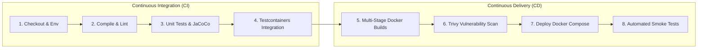

# CI/CD Strategy Document

**Document Identifier:** DOC-OPS-002  
**Traceability References:** NFR-007, DOC-OPS-001, DOC-AUTO-011  
**Automation Engine:** Jenkins Declarative Pipeline  
**Status:** Approved Baseline  

---

## 1. Executive Summary
This document defines the Continuous Integration and Continuous Delivery (CI/CD) strategy for the Task Management System. It specifies the sequential pipeline stages, branch-specific execution behaviors, automated test triggers, and quality verification gates.

---

## 2. CI/CD Stage Pipeline Flow

---

## 3. Branch-Specific Pipeline Matrix

| Pipeline Stage | Feature PR Branch (`feature/*`) | Integration Branch (`develop`) | Release Branch (`main` / Tag) |
|---|---|---|---|
| **Code Checkout** | Yes (PR Source) | Yes | Yes (Release Tag) |
| **Static Analysis (Checkstyle/SpotBugs)**| Yes (Gatekeeper) | Yes | Yes |
| **Unit & Slice Tests** | Yes ($\ge 80\%$ line coverage) | Yes | Yes |
| **Testcontainers Integration Tests** | Yes | Yes | Yes |
| **Docker Multi-Stage Build** | Skipped (Fast PR feedback) | Yes (Tagged `develop-{sha}`) | Yes (Tagged `vX.Y.Z` & `latest`)|
| **Trivy Vulnerability Scan** | Skipped | Yes (Fails on Critical CVE)| Yes |
| **Staging Compose Deployment** | Skipped | Yes | Yes |
| **Automated Smoke Test Verification** | Skipped | Yes (`/actuator/health`) | Yes (Full Postman Newman E2E) |

---

## 4. Pipeline Failure Escalation & Notification
1. **GitHub Status Checks**: Every pipeline run reports real-time commit statuses (`pending`, `success`, `failure`) directly back to the GitHub PR.
2. **Pull Request Blocking**: Pull requests are blocked from merging if any CI stage fails.
3. **Automated Log Artifacts**: Surefire test reports (`target/surefire-reports`), JaCoCo HTML coverage maps, and Trivy vulnerability summaries are archived as Jenkins build artifacts.

