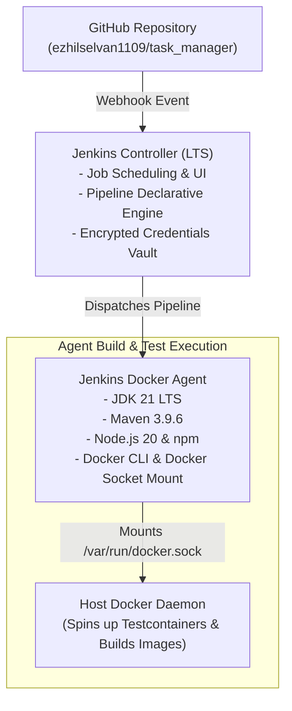

# Jenkins Architecture Document

**Document Identifier:** DOC-OPS-003  
**Traceability References:** NFR-007, DOC-OPS-001, DOC-OPS-002  
**Automation Engine:** Jenkins LTS Controller-Agent Architecture  
**Status:** Approved Baseline  

---

## 1. Executive Summary
This document specifies the Jenkins CI/CD infrastructure architecture, agent execution model, plugin ecosystem, and credential security bindings for the Task Management System.

---

## 2. Controller-Agent Execution Architecture



---

## 3. Required Jenkins Plugin Inventory

| Plugin Name | Minimum Version | Functional Purpose |
|---|---|---|
| **Pipeline (Workflow Aggregator)** | 2.6+ | Enables declarative `Jenkinsfile` execution. |
| **GitHub Integration Plugin** | 1.38+ | Manages webhooks, PR triggers, and commit status updates. |
| **Credentials Binding Plugin** | 1.29+ | Securely masks and injects credentials (`withCredentials`). |
| **JUnit Plugin** | 1.62+ | Parses Surefire XML test reports for test trend visualizations. |
| **JaCoCo Plugin** | 3.3+ | Parses coverage `jacoco.exec` and enforces quality gate thresholds. |
| **Warnings Next Generation** | 10.3+ | Aggregates and graphs Checkstyle and SpotBugs compiler warnings. |
| **Docker Pipeline Plugin** | 2.8+ | Enables native `docker.build` and `docker.image` pipeline DSL. |

---

## 4. Docker Socket Mount for Testcontainers Support

To allow the Jenkins build agent to execute Testcontainers integration tests (which spin up real PostgreSQL and Kafka containers during `mvn verify`), the agent container must mount the host Docker socket:

```yaml
# Jenkins Agent Docker Configuration
volumes:
  - /var/run/docker.sock:/var/run/docker.sock
  - maven_repo_cache:/root/.m2/repository
```

This configuration guarantees that integration tests have direct access to the local Docker daemon without requiring privileged Docker-in-Docker (DinD) security overhead.

