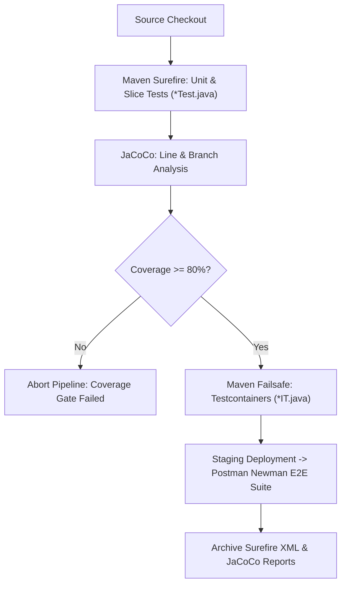

# Automated Testing in CI/CD

**Document Identifier:** DOC-OPS-006  
**Traceability References:** NFR-007, DOC-TEST-001, DOC-OPS-004  
**Plugins:** Maven Surefire, Maven Failsafe, JaCoCo, Jenkins JUnit Reporter  
**Status:** Approved Baseline  

---

## 1. Executive Summary
This document specifies how automated test suites are orchestrated, parallelized, executed, and archived within the Jenkins CI/CD pipeline. The strategy enforces deterministic test execution, rapid failure reporting, and strict quality gate compliance.

---

## 2. CI/CD Testing Lifecycle



---

## 3. Test Runner Configuration (`pom.xml`)

### 3.1 Maven Surefire Plugin (Unit Tests)
```xml
<plugin>
    <groupId>org.apache.maven.plugins</groupId>
    <artifactId>maven-surefire-plugin</artifactId>
    <version>3.2.5</version>
    <configuration>
        <includes>
            <include>**/*Test.java</include>
        </includes>
        <forkCount>1C</forkCount>
        <reuseForks>true</reuseForks>
    </configuration>
</plugin>
```

### 3.2 Maven Failsafe Plugin (Integration Tests)
```xml
<plugin>
    <groupId>org.apache.maven.plugins</groupId>
    <artifactId>maven-failsafe-plugin</artifactId>
    <version>3.2.5</version>
    <configuration>
        <includes>
            <include>**/*IT.java</include>
            <include>**/*IntegrationTest.java</include>
        </includes>
    </configuration>
    <executions>
        <execution>
            <goals>
                <goal>integration-test</goal>
                <goal>verify</goal>
            </goals>
        </execution>
    </executions>
</plugin>
```

---

## 4. Testcontainers Optimization in CI
To prevent redundant container startup overhead across multiple integration test classes:
- Test classes inherit a shared `AbstractIntegrationTest` base class declaring static singleton PostgreSQL and Kafka containers.
- Reusing container instances slashes integration test execution time from 90 seconds to **under 25 seconds** per pipeline build.

