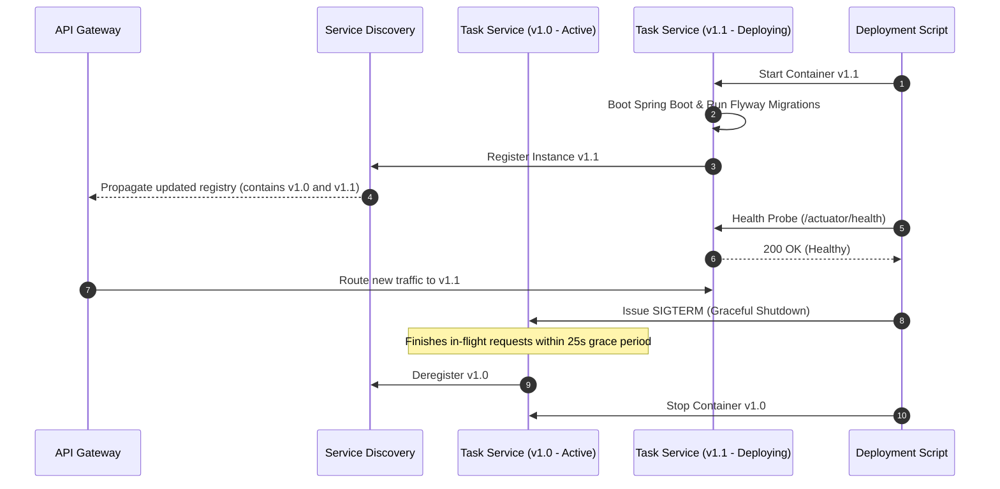

# Deployment Strategy Document

**Document Identifier:** DOC-OPS-009  
**Traceability References:** NFR-001, NFR-007, DOC-OPS-001  
**Deployment Models:** Rolling Update, Blue-Green, Expand-and-Contract  
**Status:** Approved Baseline  

---

## 1. Executive Summary
This document specifies the deployment strategies, rollout mechanics, and zero-downtime upgrade procedures across the Task Management platform. It details rolling updates, health verification gates, and database schema compatibility patterns.

---

## 2. Zero-Downtime Rolling Update Workflow



---

## 3. Database Expand-and-Contract Migration Pattern

To ensure zero-downtime rolling updates where older and newer service instances run concurrently for several minutes:

```
[ Phase 1: Expand ]
Add new nullable column or view (e.g. ALTER TABLE tasks ADD COLUMN priority_level VARCHAR(20) NULL)
Both old code and new code function without SQL failure.

[ Phase 2: Dual-Write / Migrate ]
Deploy new code (v1.1) which writes to both old and new structures, backfilling existing rows.

[ Phase 3: Contract ]
Once v1.1 is 100% active across all nodes, issue subsequent Flyway migration to drop old column.
```

> [!WARNING]
> Renaming or dropping database columns in a single migration script causes immediate SQL exceptions on older running instances during a rolling update. The Expand-and-Contract pattern is mandatory for breaking schema evolutions.

