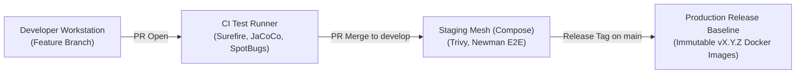

# Environment Promotion Strategy

**Document Identifier:** DOC-OPS-010  
**Traceability References:** DOC-INF-012, DOC-OPS-001, DOC-AUTO-013  
**Artifact Lifecycle:** Local Workstation $\rightarrow$ CI Pipeline $\rightarrow$ Staging $\rightarrow$ Production  
**Status:** Approved Baseline  

---

## 1. Executive Summary
This document defines the formal promotion criteria, gate verifications, and approval workflows governing the progression of artifacts from developer workstations to production deployment.

---

## 2. Environment Promotion Pipeline

---

## 3. Promotion Gate Verification Matrix

| Promotion Step | Source $\rightarrow$ Target | Mandatory Gate Criteria | Gatekeeper |
|---|---|---|---|
| **Promotion 1** | Local Workstation $\rightarrow$ Feature PR | Clean compile, 100% unit tests pass locally, zero secrets committed. | Developer / Agent |
| **Promotion 2** | Feature PR $\rightarrow$ `develop` Branch | Jenkins CI GREEN, JaCoCo $\ge 80\%$, Checkstyle 0 errors, 1 Senior Peer Approval. | Jenkins & Peer Reviewer |
| **Promotion 3** | `develop` $\rightarrow$ Staging Deployment | Multi-stage Docker build passes, Trivy 0 Critical CVEs, Actuator probes UP. | Automated Jenkins CD |
| **Promotion 4** | Staging $\rightarrow$ Production Release | Postman Newman E2E suite passes, Production Readiness Checklist signed off. | Solution Architect & Lead PM |

---

## 4. Artifact Immutability Rule
Once a container image is compiled and tagged by the CI pipeline (e.g. `taskmanager/task-service:v1.0.0`), its binary hash is sealed. The identical image promoted through Staging is deployed to Production. Configuration changes between environments occur strictly via environment variables.

