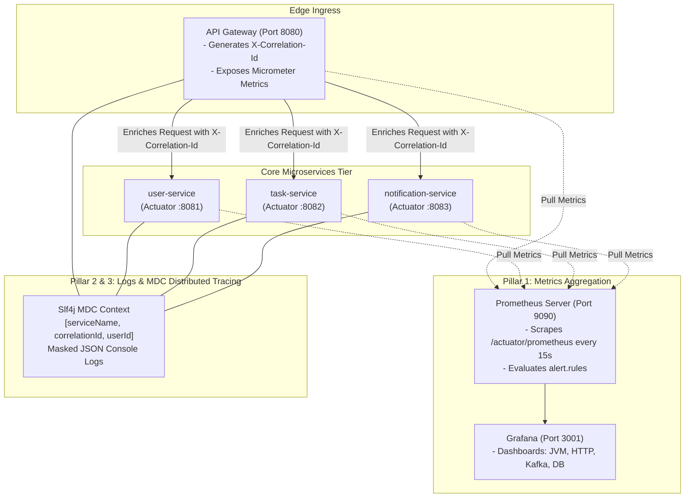

# Observability Architecture Document

**Document Identifier:** DOC-OBS-001  
**Traceability References:** NFR-004, NFR-005, Master Project Baseline  
**Pillars:** Metrics (Prometheus), Logs (Slf4j MDC), Traces (Correlation ID), Health (Actuator)  
**Status:** Approved Baseline  

---

## 1. Executive Summary
This document defines the comprehensive observability architecture for the Task Management System. Built upon the Three Pillars of Observability (Metrics, Logs, Traces), the architecture provides deep operational visibility into service health, latency profiles, database connection saturation, Kafka consumer lag, and circuit breaker states across the microservices mesh.

---

## 2. Three Pillars Observability Mesh

---

## 3. Observability Architecture Principles

1. **Correlation Across Boundaries**: Every inbound HTTP request receives or inherits an `X-Correlation-Id` at the API Gateway. This identifier is injected into Slf4j MDC, propagated across downstream HTTP headers, and stamped into Kafka event record headers (`EventEnvelope.correlationId`).
2. **Pull-Based Metrics Scraping**: Prometheus periodically pulls metrics from `/actuator/prometheus` endpoints on a 15-second scrape interval. Microservices do not require proprietary push agents.
3. **Structured JSON Logging**: Production logs output structured JSON strings with fixed schemas, enabling rapid filtering by `correlationId`, `userId`, or `level`.
4. **Zero Performance Impact**: Observability instrumentation operates asynchronously or via in-memory ring buffers (Micrometer counters and gauges), introducing negligible CPU and latency overhead ($< 1$ ms).

