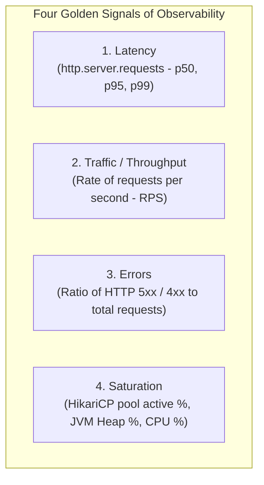

# Metrics Strategy and Micrometer Design

**Document Identifier:** DOC-OBS-003  
**Traceability References:** NFR-004, NFR-005, DOC-OBS-001  
**Frameworks:** Spring Boot Actuator 3.3.x, Micrometer, Prometheus MeterRegistry  
**Status:** Approved Baseline  

---

## 1. Executive Summary
This document specifies the metrics collection strategy, telemetry instruments, golden signals, and custom Micrometer meters across the Task Management platform.

---

## 2. Standard Metric Dimensions & Golden Signals

In accordance with Google SRE principles, the platform captures the Four Golden Signals across all microservice boundaries:



---

## 3. Core Telemetry Inventory

| Metric Name | Type | Tag Dimensions | Description |
|---|---|---|---|
| `http.server.requests` | Timer | `uri`, `method`, `status` | HTTP request execution latency and throughput. |
| `jvm.memory.used` | Gauge | `area: heap / nonheap`, `id` | Total memory consumed in bytes. |
| `jvm.gc.pause` | Timer | `action`, `cause` | Garbage collection pause duration. |
| `hikaricp.connections.active`| Gauge | `pool: HikariPool-1` | Active database connections currently in use. |
| `hikaricp.connections.pending`| Gauge| `pool: HikariPool-1` | Threads waiting to acquire a connection from pool. |
| `resilience4j.circuitbreaker.state`| Gauge| `name: taskServiceCircuitBreaker`| Current state (0 = CLOSED, 1 = OPEN, 2 = HALF_OPEN). |
| `kafka.consumer.records.lag`| Gauge | `topic`, `partition`, `group` | Unprocessed message count waiting in Kafka partitions. |

---

## 4. Custom Business & Operational Meters

Implemented via Spring `MeterRegistry` bean injection:

```java
@Component
public class TaskMetricsService {

    private final Counter taskCreatedCounter;
    private final Counter taskCompletedCounter;
    private final Counter dltRoutedCounter;
    private final AtomicInteger pendingOutboxGauge;

    public TaskMetricsService(MeterRegistry registry, OutboxEventRepository outboxRepository) {
        this.taskCreatedCounter = Counter.builder("task.created.total")
                .description("Total number of tasks created")
                .register(registry);

        this.taskCompletedCounter = Counter.builder("task.completed.total")
                .description("Total number of tasks marked completed")
                .register(registry);

        this.dltRoutedCounter = Counter.builder("kafka.consumer.dlt.routed")
                .description("Total poison pills redirected to DLT")
                .register(registry);

        this.pendingOutboxGauge = registry.gauge("task.outbox.pending.gauge",
                new AtomicInteger(0));
    }

    public void incrementTaskCreated() {
        taskCreatedCounter.increment();
    }

    public void updatePendingOutboxCount(int count) {
        pendingOutboxGauge.set(count);
    }
}
```

