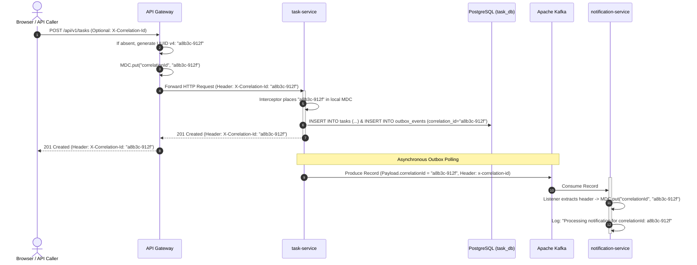

# Distributed Tracing Specification

**Document Identifier:** DOC-OBS-004  
**Traceability References:** NFR-004, DOC-OBS-001, DOC-OBS-002  
**Tracing Mechanism:** Correlation ID (`X-Correlation-Id`), MDC, Kafka Record Headers  
**Status:** Approved Baseline  

---

## 1. Executive Summary
This document specifies the distributed tracing architecture across the Task Management platform. It defines the lifecycle, propagation mechanisms, and header serialization rules governing the `X-Correlation-Id` across synchronous HTTP calls and asynchronous Kafka messaging streams.

---

## 2. Distributed Tracing Flowchart

---

## 3. Correlation Propagation Standards

1. **HTTP Ingress Rule**:
   - If incoming request contains `X-Correlation-Id`, validate format (UUID v4 regex: `^[0-9a-fA-F-]{36}$`). If valid, retain it; if invalid or missing, generate a new UUID.
2. **HTTP Outbound Rule**:
   - Every response from API Gateway includes header:
     `X-Correlation-Id: 3fa85f64-5717-4562-b3fc-2c963f66afa6`
   - Enables users and frontend error modals to reference the exact server execution trace when submitting bug reports.
3. **Kafka Header Rule**:
   - Outbox poller injects standard byte-encoded Kafka header:
     `record.headers().add("x-correlation-id", correlationId.getBytes(StandardCharsets.UTF_8))`
4. **Log Context Hygiene**:
   - Servlets and Kafka listeners execute `MDC.remove("correlationId")` inside `finally` blocks to prevent thread-pool context leakage.

