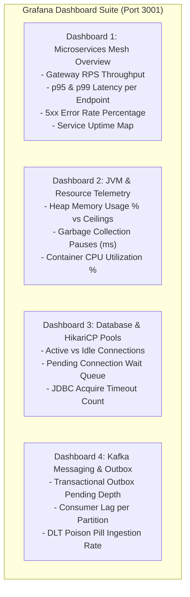

# Grafana Dashboard Design Document

**Document Identifier:** DOC-OBS-006  
**Traceability References:** NFR-004, DOC-INF-005, DOC-OBS-003, DOC-OBS-005  
**Visualization Tool:** Grafana 10.4.x  
**Status:** Approved Baseline  

---

## 1. Executive Summary
This document specifies the Grafana visualization dashboards, panel layouts, automated provisioning configs, and PromQL telemetry queries for real-time monitoring of the Task Management Microservices platform.

---

## 2. Automated Datasource Provisioning

Configured in `infrastructure/grafana/provisioning/datasources/prometheus.yml`:

```yaml
apiVersion: 1

datasources:
  - name: Prometheus
    type: prometheus
    access: proxy
    url: http://prometheus:9090
    isDefault: true
    editable: false
```

---

## 3. Core Operational Dashboards Layout



---

## 4. PromQL Telemetry Query Catalogue

### 4.1 System Mesh Overview Queries
- **Throughput (Requests Per Second)**:
  ```promql
  sum(rate(http_server_requests_seconds_count[1m])) by (service)
  ```
- **p95 HTTP Request Latency**:
  ```promql
  histogram_quantile(0.95, sum(rate(http_server_requests_seconds_bucket[1m])) by (le, service))
  ```
- **HTTP 5xx Error Rate Percentage**:
  ```promql
  sum(rate(http_server_requests_seconds_count{status=~"5.."}[1m])) 
  / sum(rate(http_server_requests_seconds_count[1m])) * 100
  ```
- **Service Liveness Grid**:
  ```promql
  up{job=~"api-gateway|user-service|task-service|notification-service|service-discovery"}
  ```

### 4.2 Database & Messaging Queries
- **HikariCP Connection Pool Saturation %**:
  ```promql
  hikaricp_connections_active / (hikaricp_connections_active + hikaricp_connections_idle) * 100
  ```
- **Pending Outbox Queue Depth**:
  ```promql
  task_outbox_pending_gauge
  ```
- **Kafka Consumer Lag**:
  ```promql
  sum(kafka_consumer_records_lag{group="notification-service-group"}) by (topic, partition)
  ```
- **Circuit Breaker Open State**:
  ```promql
  resilience4j_circuitbreaker_state{state="open"}
  ```

