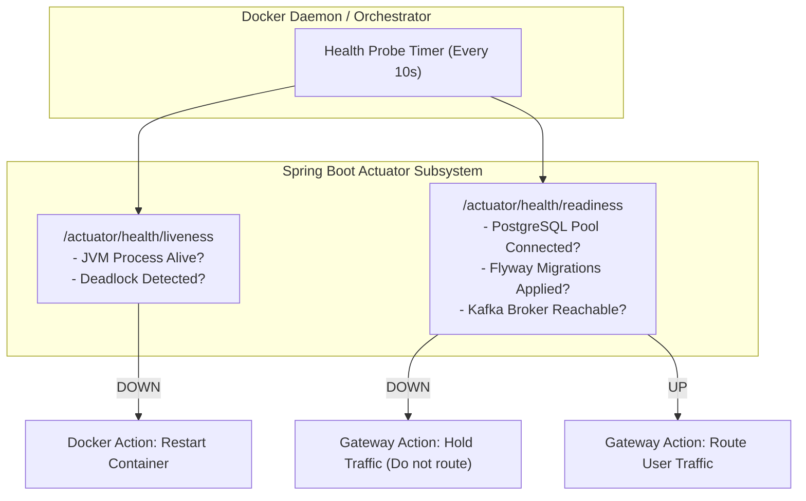

# Health Check Strategy and Actuator Probes

**Document Identifier:** DOC-OBS-008  
**Traceability References:** NFR-001, NFR-004, DOC-INF-006  
**Framework:** Spring Boot 3.3.x Actuator Health Subsystem  
**Status:** Approved Baseline  

---

## 1. Executive Summary
This document specifies the health checking architecture, Actuator probe configurations, component health indicators, and Docker container healthcheck mappings across the Task Management platform.

---

## 2. Liveness vs Readiness Probe Architecture



---

## 3. Actuator Configuration Specification (`application.yml`)

Configured across all microservices:

```yaml
management:
  endpoints:
    web:
      exposure:
        include: health,info,prometheus,metrics
  endpoint:
    health:
      show-details: always
      probes:
        enabled: true
  health:
    livenessstate:
      enabled: true
    readinessstate:
      enabled: true
    db:
      enabled: true
    diskspace:
      enabled: true
```

---

## 4. Aggregated Health Response Example (`GET /actuator/health`)

```json
{
  "status": "UP",
  "components": {
    "db": {
      "status": "UP",
      "details": {
        "database": "PostgreSQL",
        "validationQuery": "isValid()"
      }
    },
    "diskSpace": {
      "status": "UP",
      "details": {
        "total": 52710506496,
        "free": 38102917120,
        "threshold": 10485760
      }
    },
    "livenessState": {
      "status": "UP"
    },
    "readinessState": {
      "status": "UP"
    }
  }
}
```
If PostgreSQL or Kafka drops, `readinessState` automatically flips to `DOWN`, alerting Prometheus and triggering graceful traffic isolation.

