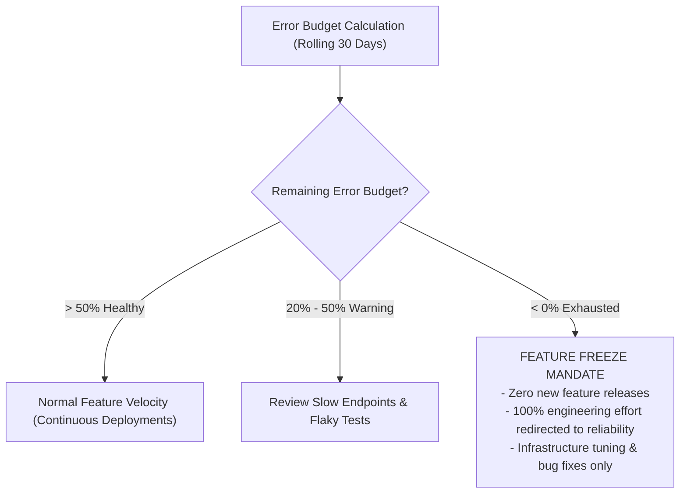

# Service Level Objectives (SLO) Proposals

**Document Identifier:** DOC-OBS-010  
**Traceability References:** NFR-001, NFR-002, DOC-OBS-009  
**Methodology:** Google SRE Service Level Objectives & Error Budget Policy  
**Status:** Approved Baseline  

---

## 1. Executive Summary
This document defines the proposed Service Level Objectives (SLOs) and Error Budget governance policies for the Task Management System. SLOs set measurable reliability targets that balance delivery velocity with system stability.

---

## 2. Proposed Service Level Objectives (30-Day Rolling Window)

| SLO Identifier | Target Service / Domain | Proposed Objective | 30-Day Error Budget | Error Budget Impact |
|---|---|---|---|---|
| **`SLO-001`** | **Edge API Gateway Availability** | **$\ge 99.9\%$** of valid HTTP requests succeed (non-5xx). | **0.1%** (~43 minutes 12 seconds downtime allowed) | Core user access |
| **`SLO-002`** | **Task Read Latency** | **$\ge 99.0\%$** of `GET` task queries complete in $< 100$ ms. | **1.0%** of total read requests | Interactive search & list |
| **`SLO-003`** | **Task Mutation Latency** | **$\ge 95.0\%$** of `POST/PUT/PATCH` requests complete in $< 200$ ms. | **5.0%** of total mutations | Task creation & status updates |
| **`SLO-004`** | **Outbox Relay Speed** | **$\ge 99.0\%$** of outbox records published to Kafka within 1 second. | **1.0%** of total outbox events | Messaging pipeline throughput |
| **`SLO-005`** | **Notification Ingestion** | **$\ge 95.0\%$** of notifications delivered to user tray within 2 seconds. | **5.0%** of total notifications | Real-time user feedback |

---

## 3. Error Budget Governance Policy

1. **Exhaustion Actions**: If `SLO-001` (99.9% availability) exhausts its 0.1% error budget, automated feature deployments to staging are paused.
2. **Restoration Protocol**: Feature deployments resume only after the rolling 30-day budget recovers above 20%.

