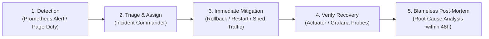

# Incident Management Procedure

**Document Identifier:** DOC-OBS-011  
**Traceability References:** NFR-002, NFR-006, DOC-OBS-007, DOC-OPS-011  
**Framework:** ITIL / SRE Blameless Incident Management  
**Status:** Approved Baseline  

---

## 1. Executive Summary
This document specifies the operational incident management lifecycle, on-call triage protocols, escalation ladders, and blameless post-mortem standards across the Task Management platform.

---

## 2. Incident Response Lifecycle



> [!CRITICAL]
> **Primary Rule of Incident Mitigation**:  
> During an active P1/P2 outage, the **sole priority is service restoration**, not deep debugging. Execute rollback or restart degraded containers first. Preserve log dumps for subsequent offline analysis.

---

## 3. Incident Priority Classification and Escalation Matrix

| Priority | Criteria & Impact | Response SLA | Target MTTR | Escalation Lead |
|---|---|---|---|---|
| **P1 - Critical** | Total platform outage, user authentication down, active security breach. | **$< 5$ minutes** | **$< 30$ minutes** | Solution Architect & Engineering Lead |
| **P2 - Major** | High error rate ($>5\%$), `task-service` circuit breaker open, Kafka down. | **$< 15$ minutes** | **$< 2$ hours** | Service Tech Lead |
| **P3 - Minor** | Degraded background notifications, slow queries on dashboard. | **$< 1$ hour** | **$< 8$ hours** | On-call Engineer |
| **P4 - Low** | Minor metric discrepancy, cosmetic log formatting error. | Next Business Day | Next Sprint | Assigned Developer |

---

## 4. Blameless Post-Mortem Template

Post-mortems must be published to `documentation/post-mortems/` within 48 hours of any P1/P2 incident:

```markdown
# Incident Post-Mortem: [INCIDENT-ID]

## 1. Incident Overview
- **Date & Time:** YYYY-MM-DD HH:MM UTC
- **Duration:** XX minutes
- **Impacted Services:** api-gateway, task-service
- **Incident Commander:** [Name]

## 2. Executive Summary
Brief summary of the incident, impact on users, and final resolution.

## 3. Timeline (UTC)
- 18:00 - Prometheus alert MicroserviceDown fires.
- 18:02 - On-call engineer initiates triage.
- 18:05 - Rollback runbook DOC-OPS-011 executed.
- 18:08 - Health probes green; service fully recovered.

## 4. Root Cause Analysis (5 Whys)
Systematic root cause analysis without assigning human blame.

## 5. Preventative Action Items
- [ ] Action item 1 (Ticket #) - Assigned to [Owner]
- [ ] Action item 2 (Ticket #) - Assigned to [Owner]
```

