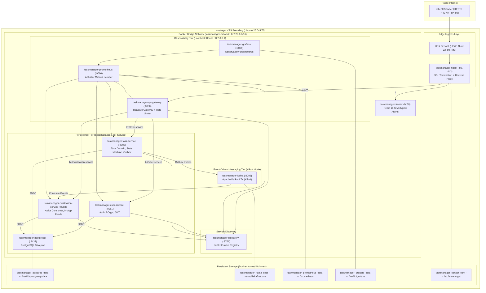
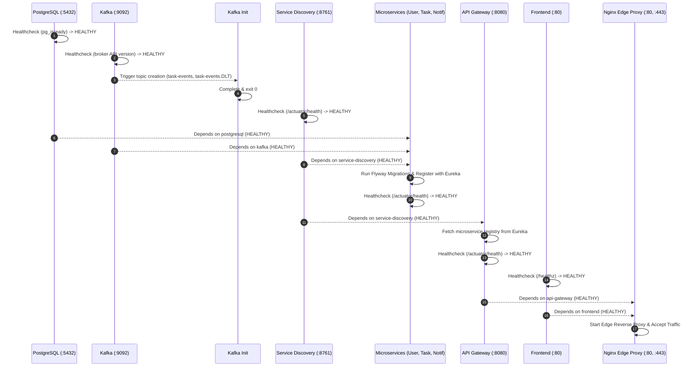

# Docker Deployment Architecture

| Field | Value |
|---|---|
| **Document ID** | DOC-DEP-001 |
| **Title** | Production Docker Deployment Architecture |
| **Project** | Task Management System – Microservices Architecture |
| **Target Infrastructure** | Hostinger VPS (Ubuntu 26.04 LTS, KVM 4, 4 vCPU, 16 GB RAM, 200 GB NVMe) |
| **Deployment Platform** | Docker Engine 26.x + Docker Compose v2.x |
| **Status** | Approved Production Baseline |
| **Traceability Reference** | ADR-001, ADR-002, ADR-003, ADR-004, ADR-006, ADR-008, DOC-ARCH-001, DOC-INF-001 |

---

## 1. Architectural Overview

The Task Management System is deployed as a single-host, multi-container orchestration mesh on a **Hostinger KVM 4 VPS** running **Ubuntu 26.04 LTS**. All services operate within isolated Docker containers communicating across an internal, bridge-based Docker software-defined network (`taskmanager-network`).

Public ingress into the VPS is strictly mediated by an **Edge Nginx Reverse Proxy** that terminates SSL/TLS, manages ACME certificate challenges, and routes traffic either to the compiled React 18 Single Page Application (`frontend`) or through the Spring Cloud API Gateway (`api-gateway`). Zero internal service ports (PostgreSQL, Kafka, Eureka, User Service, Task Service, Notification Service, Prometheus) are exposed to public interfaces (`0.0.0.0`).

---

## 2. Ingress & Perimeter Routing Strategy

1. **Edge Reverse Proxy (`taskmanager-nginx`)**:
   - The only container binding to public host ports `80` (HTTP) and `443` (HTTPS).
   - Handles Let's Encrypt HTTP-01 challenges via webroot path `/.well-known/acme-challenge/`.
   - Automatically upgrades insecure HTTP traffic to HTTPS via `301 Moved Permanently`.
   - Injects and preserves request tracing headers (`X-Correlation-ID`).
   - Forwards real client IP metadata (`X-Real-IP`, `X-Forwarded-For`, `X-Forwarded-Proto`).
   - Applies gzip compression and rate limiting on upstream requests.

2. **Frontend Static Routing (`/`)**:
   - Forwarded internally to `taskmanager-frontend:80`.
   - Serves pre-compiled static assets produced by Vite (`dist/`).
   - Supports SPA client-side routing fallback via `try_files $uri $uri/ /index.html`.

3. **Backend API Routing (`/api/**`)**:
   - Forwarded internally to `taskmanager-api-gateway:8080`.
   - Routes authenticated and public requests to downstream microservices through Eureka service discovery (`lb://user-service`, `lb://task-service`, `lb://notification-service`).

---

## 3. Storage Architecture & Persistent Volumes

All stateful containers utilize Docker named volumes mapped to high-performance NVMe storage on the Hostinger VPS:

| Volume Name | Target Container Path | Content Description | Backup Priority |
|---|---|---|---|
| `taskmanager_postgres_data` | `/var/lib/postgresql/data` | PostgreSQL 16 database clusters (`user_db`, `task_db`, `notification_db`) | **CRITICAL** (Daily automated pg_dump) |
| `taskmanager_kafka_data` | `/var/lib/kafka/data` | Kafka KRaft metadata log segments, partition event topics, and consumer offsets | **HIGH** (Persistent topic retention) |
| `taskmanager_prometheus_data` | `/prometheus` | Prometheus Time Series Database (TSDB) metrics (15-day retention) | **MEDIUM** (Operational observability) |
| `taskmanager_grafana_data` | `/var/lib/grafana` | Grafana dashboard state, SQLite database, and user settings | **MEDIUM** (Operational observability) |
| `taskmanager_certbot_conf` | `/etc/letsencrypt` | Active SSL/TLS certificates and private keys managed by Certbot | **CRITICAL** (Security & TLS continuity) |
| `taskmanager_certbot_www` | `/var/www/certbot` | ACME challenge validation tokens for automated renewals | **LOW** (Transient challenge files) |

---

## 4. Network Isolation & Security Perimeter

1. **Subnet Allocation**:
   - Network Name: `taskmanager-network`
   - Driver: `bridge`
   - Subnet: `172.28.0.0/16`
2. **DNS & Service Aliases**:
   - All inter-service communication resolves via Docker's embedded DNS server (`127.0.0.11`).
   - Containers utilize well-defined DNS service aliases: `postgresql`, `kafka`, `service-discovery`, `api-gateway`, `user-service`, `task-service`, `notification-service`, `frontend`, `prometheus`, `grafana`.
3. **Concealment of Internal Services (`RULE-05`)**:
   - PostgreSQL (`5432`), Kafka (`9092`), Eureka (`8761`), and internal microservice HTTP ports (`8081`, `8082`, `8083`) are never bound to `0.0.0.0`.
   - Administrative ports (Postgres, Prometheus, Grafana) bind strictly to loopback (`127.0.0.1`), enabling secure access via SSH port forwarding (`ssh -L 9090:127.0.0.1:9090 user@vps-ip`).

---

## 5. Microservice Lifecycle & Dependency Sequencing

Docker Compose orchestrates container startup order using health check evaluation:

