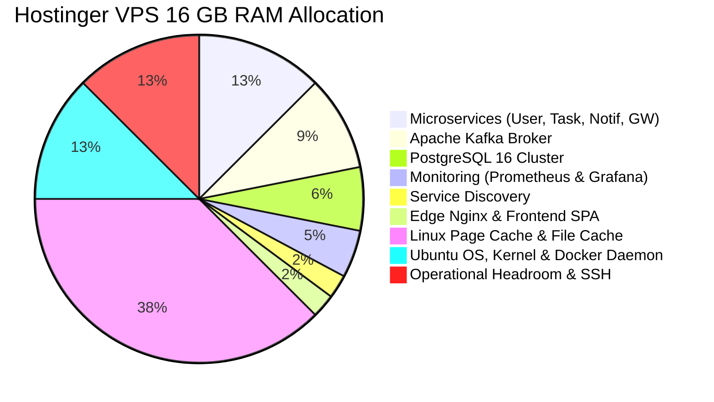

# Docker Resource Management & Memory Budget

| Field | Value |
|---|---|
| **Document ID** | DOC-DEP-008 |
| **Title** | Production Container Resource Budget & Capacity Allocation |
| **Project** | Task Management System – Microservices Architecture |
| **Target Host** | Hostinger VPS KVM 4 (4 vCPU, 16.0 GB RAM, 200 GB NVMe Disk) |
| **Status** | Approved Production Baseline |
| **Traceability Reference** | ADR-003, DOC-INF-006, RULE-10 |

---

## 1. Executive Summary & Host Capacity Overview

The resource allocation strategy guarantees that all 11 production containers run comfortably with strict performance guardrails while reserving ample memory and CPU capacity for the host operating system, Docker daemon, Linux page cache, and operational tasks.

### 1.1 Host Capacity Metrics
- **Total Physical RAM**: 16,384 MB (16.0 GB)
- **Total vCPUs**: 4 Virtual Cores
- **Total NVMe Storage**: 200 GB
- **Container Memory Allocation**: 6,144 MB (6.0 GB, **37.5% of host RAM**)
- **Unallocated Host Memory**: 10,240 MB (10.0 GB, **62.5% of host RAM**)



---

## 2. Container Memory Allocation Matrix

| Service | Container Name | Memory Limit (`mem_limit`) | JVM Heap (`-Xms / -Xmx`) | Off-Heap / Native Allocation | CPU Limit | Purpose & Sizing Rationale |
|---|---|---|---|---|---|---|
| `postgresql` | `taskmanager-postgresql` | **1024 MB** (1.0 GB) | N/A (C Native) | Shared Buffers: 256 MB, Work Mem: 16 MB | 1.5 vCPU | Houses `user_db`, `task_db`, `notification_db`. Adequate for 50 concurrent active connections. |
| `kafka` | `taskmanager-kafka` | **1536 MB** (1.5 GB) | `-Xms512m -Xmx1024m` | Native / Page Cache: 512 MB | 1.5 vCPU | Apache Kafka KRaft broker, topic segment compaction, and offset caching. |
| `service-discovery` | `taskmanager-discovery` | **384 MB** | `-Xms128m -Xmx256m` | Metaspace / Thread Stacks: 128 MB | 0.75 vCPU | Netflix Eureka service discovery registry and heartbeat tracking. |
| `api-gateway` | `taskmanager-api-gateway` | **512 MB** | `-Xms128m -Xmx384m` | Netty Direct Buffers: 128 MB | 1.0 vCPU | Reactive non-blocking gateway, rate limiter, and JWT filter pipeline. |
| `user-service` | `taskmanager-user-service` | **512 MB** | `-Xms128m -Xmx384m` | Metaspace / Thread Stacks: 128 MB | 1.0 vCPU | BCrypt password hashing (Cost 12), JWT generation, user persistence. |
| `task-service` | `taskmanager-task-service` | **512 MB** | `-Xms128m -Xmx384m` | Metaspace / Thread Stacks: 128 MB | 1.0 vCPU | Task state transitions, Transactional Outbox poller (`SKIP LOCKED`). |
| `notification-service` | `taskmanager-notification-service` | **512 MB** | `-Xms128m -Xmx384m` | Metaspace / Thread Stacks: 128 MB | 1.0 vCPU | Idempotent Kafka consumer, event deduplication, in-app notification repository. |
| `frontend` | `taskmanager-frontend` | **128 MB** | N/A (Nginx C) | Buffer / Cache: 128 MB | 0.5 vCPU | Nginx static file serving for React 18 production bundle (`dist/`). |
| `nginx` | `taskmanager-nginx` | **256 MB** | N/A (Nginx C) | Connection Buffers: 256 MB | 0.5 vCPU | Edge reverse proxy, SSL termination, and gzip compression. |
| `prometheus` | `taskmanager-prometheus` | **512 MB** | N/A (Go Native) | TSDB Buffers: 512 MB | 0.75 vCPU | Time Series Database scraping actuator endpoints with 15-day retention. |
| `grafana` | `taskmanager-grafana` | **256 MB** | N/A (Go Native) | Dashboard Rendering: 256 MB | 0.5 vCPU | Visualization dashboards, SQLite configuration database. |
| **TOTALS** | **11 Containers** | **6,144 MB (6.0 GB)** | **~3,328 MB Heap** | **~2,816 MB Native/Off-heap** | **4.0 Cores Max** | Leaves 10.0 GB host headroom. |

---

## 3. Host System Memory & Headroom Analysis

Why is reserving 10.0 GB (62.5%) of memory for the host critical?

1. **Linux Kernel Page Cache for Kafka**:
   - Apache Kafka relies on the Linux OS page cache (not JVM heap) to achieve ultra-fast sequential disk I/O.
   - Reserving 4-6 GB of page cache allows Kafka to read and write event segments in memory without synchronous NVMe writes.
2. **PostgreSQL Effective Cache**:
   - PostgreSQL leverages OS file cache beyond `shared_buffers` (256 MB). The remaining memory allows PostgreSQL to cache index scans and table pages.
3. **Preventing Out-of-Memory (OOM) Killer Invocations**:
   - If containers are assigned 15 GB on a 16 GB host, temporary spikes during Maven builds, backup compressions (`gzip`), or APT package upgrades will cause the Linux kernel OOM killer to terminate random containers.
   - A 10 GB headroom guarantees absolute host stability.

---

## 4. Storage Budget Allocation (200 GB NVMe Disk)

```
200 GB Total Hostinger NVMe Storage
│
├── Operating System & Binaries  ───► ~15 GB (Ubuntu 26.04, packages, Docker Engine)
├── Docker Image Cache & Layers   ───► ~10 GB (Base images, builder caches)
├── PostgreSQL Persistent Data   ───► ~40 GB (3 Databases + WAL logs)
├── Kafka Log Segment Retention  ───► ~30 GB (Event topics with 7-day retention)
├── Prometheus TSDB Metrics      ───► ~15 GB (15-day retention)
├── Backup Snapshots (/backups)  ───► ~40 GB (Daily automated pg_dump gzip archives)
└── Free Operational Space        ───► ~50 GB (Available for log rotation and expansion)
```

