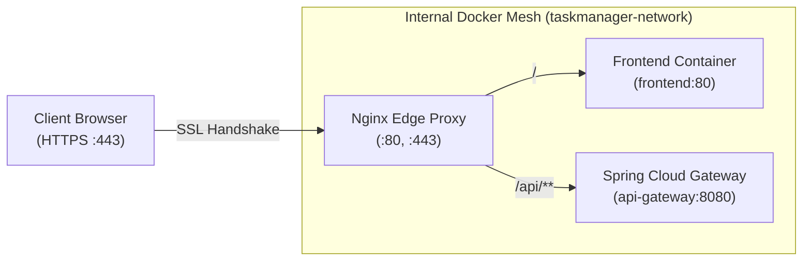

# Production Nginx & HTTPS (SSL/TLS) Setup Guide

| Field | Value |
|---|---|
| **Document ID** | DOC-DEP-006 |
| **Title** | Production Nginx Edge Reverse Proxy & HTTPS Configuration Guide |
| **Project** | Task Management System – Microservices Architecture |
| **Component** | `taskmanager-nginx` Container |
| **Status** | Approved Production Baseline |
| **Traceability Reference** | ADR-001, ADR-004, ADR-008, DOC-INF-008, DOC-DEP-001 |

---

## 1. Edge Reverse Proxy Architecture

The production Nginx reverse proxy serves as the sole perimeter entry point to the Hostinger VPS:



---

## 2. DNS Record Prerequisites

Before initiating SSL/TLS certificate provisioning, configure your domain's authoritative DNS records to point to your Hostinger VPS static IPv4 address:

| Record Type | Host / Name | Value / Target | TTL | Description |
|---|---|---|---|---|
| **A** | `@` (root) | `YOUR_VPS_IP` | 300 | Points apex domain (e.g. `yourdomain.com`) to VPS |
| **A** | `www` | `YOUR_VPS_IP` | 300 | Points `www.yourdomain.com` to VPS |
| **A** | `api` (Optional) | `YOUR_VPS_IP` | 300 | Optional dedicated subdomain |

Verify DNS propagation before requesting certificates:
```bash
dig +short yourdomain.com
nslookup yourdomain.com
```

---

## 3. Let's Encrypt SSL/TLS Certificate Issuance (ACME Webroot)

### 3.1 Initial Setup Before SSL Certificates Exist
On initial VPS deployment, Nginx starts in HTTP mode (Port 80) to serve the ACME challenge directory.

The Docker Compose configuration mounts:
- `certbot_www` volume $\rightarrow$ `/var/www/certbot` (Inside Nginx)
- `certbot_conf` volume $\rightarrow$ `/etc/letsencrypt` (Inside Nginx)

### 3.2 Obtaining Certificate with Certbot
Execute Certbot on the Ubuntu VPS host:

```bash
# 1. Install Certbot
apt install -y certbot

# 2. Issue certificate via Docker webroot challenge directory
certbot certonly --webroot \
  -w /var/lib/docker/volumes/taskmanager_certbot_www/_data \
  -d yourdomain.com -d www.yourdomain.com \
  --email admin@yourdomain.com \
  --agree-tos --no-eff-email

# 3. Verify certificates were generated in volume directory
ls -la /var/lib/docker/volumes/taskmanager_certbot_conf/_data/live/yourdomain.com/
```

### 3.3 Linking Certificates into Nginx Configuration
Update `infrastructure/nginx/conf.d/app.conf`:
```nginx
ssl_certificate /etc/letsencrypt/live/yourdomain.com/fullchain.pem;
ssl_certificate_key /etc/letsencrypt/live/yourdomain.com/privkey.pem;
```

Reload Nginx without downtime:
```bash
docker compose -f docker-compose.prod.yml exec nginx nginx -s reload
```

---

## 4. HTTP-to-HTTPS Redirection & Security Headers

Once certificates are verified, uncomment the automatic HTTP $\rightarrow$ HTTPS redirect in `infrastructure/nginx/conf.d/app.conf`:

```nginx
server {
    listen 80;
    listen [::]:80;
    server_name yourdomain.com www.yourdomain.com;

    location /.well-known/acme-challenge/ {
        root /var/www/certbot;
        allow all;
    }

    location / {
        return 301 https://$host$request_uri;
    }
}
```

### 4.1 Enforced Security Headers
- **HSTS**: `Strict-Transport-Security: max-age=63072000; includeSubDomains; preload`
- **Clickjacking Protection**: `X-Frame-Options: SAMEORIGIN`
- **MIME Sniffing Protection**: `X-Content-Type-Options: nosniff`
- **XSS Filter**: `X-XSS-Protection: 1; mode=block`
- **Referrer Policy**: `Referrer-Policy: strict-origin-when-cross-origin`
- **Content Security Policy**: `default-src 'self'; script-src 'self' 'unsafe-inline'; ...`

---

## 5. Header Forwarding & Traceability (`X-Correlation-ID`)

Nginx is configured to preserve distributed tracing headers and client network metadata across all proxied API requests:

```nginx
location /api/ {
    proxy_pass http://gateway_upstream;
    proxy_http_version 1.1;

    # Client IP and Protocol Preservation
    proxy_set_header Host $host;
    proxy_set_header X-Real-IP $remote_addr;
    proxy_set_header X-Forwarded-For $proxy_add_x_forwarded_for;
    proxy_set_header X-Forwarded-Proto $scheme;

    # Distributed Tracing Correlation ID (RULE-09)
    proxy_set_header X-Correlation-ID $http_x_correlation_id;

    # Upstream Connection Re-use
    proxy_set_header Connection "";

    # Request Body Limit & Timeouts
    client_max_body_size 10M;
    proxy_connect_timeout 5s;
    proxy_read_timeout 60s;
    proxy_send_timeout 60s;
}
```

---

## 6. Automated Zero-Downtime Certificate Renewal

Let's Encrypt certificates are valid for 90 days. Configure an automated bi-monthly cron job on Ubuntu:

```bash
# Add renewal cron job
cat <<'EOF' > /etc/cron.daily/certbot-renew
#!/bin/bash
certbot renew --webroot -w /var/lib/docker/volumes/taskmanager_certbot_www/_data --quiet
docker compose -f /opt/taskmanager/docker-compose.prod.yml exec -T nginx nginx -s reload
EOF

chmod +x /etc/cron.daily/certbot-renew
```

Dry-run test:
```bash
certbot renew --dry-run
```

